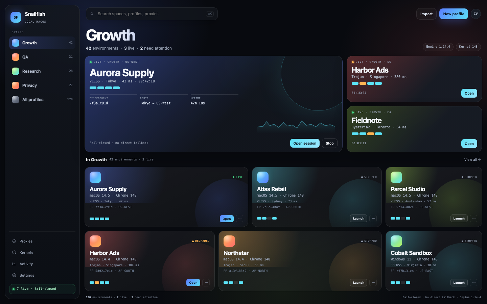

# Design System: Mien Deep Current

## Overview

**Creative North Star: "Deep Current"**

Mien 的操作表面是一个深色、空间化的工作环境，不是后台管理页。Space 是水流，档案是带有各自光色的身份，运行中的会话是必须被看见的信号；界面要同时表达“环境很深”和“操作很稳”。

这里没有表格，也没有常驻右侧检查器。首屏由 Space 侧轨、命令栏、Live session 面板和 profile 字段组成。用户先看见空间和正在运行的会话，再扫视档案、打开证据、执行启动或停止。深色不是装饰，它把注意力留给状态与验证；彩色身份光让每个档案可辨认，但绝不代替状态。

**Key Characteristics:**

- 深色、压力舱式的空间外壳，表面轻微浮起。
- Space 侧轨承载分组身份与计数；当前 Space 用渐变底强调。
- 大型 Live session 面板与右侧双卡叠放；运行状态是第一层信息。
- 12 列不等宽 profile 字段，包含宽、中、窄三档。
- 每个 profile 有确定性的 seed aura、四段 proof strip 与直接动作。
- 大号紧排标题、系统 UI 字体、等宽证据文本。
- 状态色只用于状态；身份色只用于身份。

## Colors

### Ground and surfaces

| Token | Value | Use |
| --- | --- | --- |
| `--bg` | `#080A0F` | 页面最底层，Abyss |
| `--panel` | `#0D1016` | Space 侧轨、命令栏等结构面板 |
| `--surface` | `#11151C` | 常规卡片、输入框 |
| `--raised` | `#171C25` | 浮层、选中项、需要再抬一层的表面 |
| `--ink` | `#F4F7FC` | 主文本、标题 |
| `--muted` | `#8E97A8` | 次要文本、说明 |
| `--faint` | `#7C8696` | 证据标签、页脚、低优先级元数据；在 8–10px 下仍满足 AA |
| `--line` | `rgba(255,255,255,.09)` | 卡片与结构边界 |
| `--line-soft` | `rgba(255,255,255,.055)` | 分隔线、内部分区 |

### Identity pairs

身份色用于 Space、profile orb 与 seed aura，不用于状态。

| Space | Gradient | Use |
| --- | --- | --- |
| Growth | `#5B7CFF → #5BE1F5` | 示例 Space；主操作与生长类环境 |
| QA | `#FF6B6B → #FFB454` | 示例 Space；验证与缺陷类环境 |
| Research | `#B8F25A → #5BE1F5` | 示例 Space；研究类环境 |
| Privacy | `#FFB454 → #FF6B6B` | 示例 Space；隐私类环境 |
| All profiles | `#8E97A8 → #4A5262` | 全量视图，不使用彩色身份 |

Space 名称与计数可以由产品自定义；上表是首屏示例，不是固定业务枚举。

### State colors

| Token | Value | Use |
| --- | --- | --- |
| `--running` | `#45D483` | 运行中、健康 |
| `--verified` | `#5BE1F5` | proof strip 中已验证 |
| `--warning` | `#FFB454` | 降级、需要关注 |
| `--failed` | `#FF6B6B` | 崩溃、失败、阻断 |
| `--stopped` | `#8E97A8` | 已停止、未运行 |

**The Identity Light Rule.** 身份色以低不透明度 aura、orb 或 Space 渐变出现；它永远不表示状态，也不把整张卡铺满高饱和色。Live session 大卡可以使用最多 38% 的身份色 wash。

**The State Signal Rule.** 状态必须同时有文本、圆点或 proof block 与颜色；颜色永远不是唯一信号。身份色与状态色可以撞色，含义由位置、形状和标签承担。

**The No Pure Ground Rule.** 不使用纯黑 `#000` 或纯白 `#fff` 作为大面积底色。Abyss 与 Ink 是这套系统的两端。

**The One Gradient Title Rule.** 只有 Space 标题可以使用低对比的冷色渐变文字；正文、数字、按钮和卡片标题不得使用渐变文字，也不得出现彩虹渐变。

**The No Glass Rule.** 不使用 `backdrop-filter`、磨砂玻璃或大面积模糊。深度来自表面层级、1px 边界、低透明渐变与柔光，不来自玻璃。

**The Ambient Aurora Rule.** 页面底层可以有一层极低不透明度的环境光，用来避免死黑并建立“深水”感；它不承载身份或状态含义，也不能替代卡片自身的表面与边界。

## Typography

**Display and Body:** `-apple-system, BlinkMacSystemFont, "Segoe UI", "PingFang SC", "Hiragino Sans GB", "Microsoft YaHei", sans-serif`

**Evidence:** `ui-monospace, SFMono-Regular, Menlo, Consolas, monospace`

系统 UI 字体承担全部界面文本；等宽字体承担标识、种子、延迟、端口、引擎/内核版本与 proof 标签。中文标签不强制大写，英文短标签可以使用等宽大写。

| Role | Size | Weight | Line height | Tracking |
| --- | --- | --- | --- | --- |
| Space title | 46px | 760 | 0.95 | -0.055em |
| Live session title | 31px | 700 | 1.05 | -0.035em |
| Live mini title | 22px | 700 | 1.05 | -0.035em |
| Profile title | 17px | 700 | 1.12 | -0.03em |
| Body | 13px | 400 | 1.45 | 0 |
| Card meta | 9-10px | 400-500 | 1.4 | 0.01-0.03em |
| Label | 8-9px | 600 | 1.3 | 0.11-0.14em |
| Data | 9-10px | 500 | 1.3 | 0.02-0.04em |

**The Mono Is Evidence Rule.** 等宽文本只用于标识、度量、版本与验证信息，不用于散文、按钮文案或装饰性的“技术感”。

**The Tabular Rule.** 延迟、计数、种子与端口使用 tabular numerals；对齐比字重更重要。

**The Tight Display Rule.** 大标题紧排、字重高、行高小于 1；卡片正文保持可读行高，不跟随标题压缩。

## Layout

### Shell

- 1440×900 首屏：14px 外边距，14px 间距，222px Space 侧轨，主区自适应。
- 顶部命令栏 54px；Space 标题区约 80px；Live session 面板 286px；profile 字段占据剩余高度；页脚 12px。
- Space 侧轨为 20px 圆角面板，内部使用 12px 内边距；主区不使用外层大卡片包裹。
- 首屏显示 3 个 Live session 与 6 个 profile；其余档案滚动查看。

### Space rail

- 侧轨从上到下：品牌、Spaces 列表、底部工具、全局状态。
- 当前 Space 使用身份渐变底，不增加粗色条或外发光边框。
- 每个 Space 显示身份 orb、名称与档案计数；不显示运行中数量，避免与全局状态重复。
- 底部工具为 Proxies、Kernels、Activity、Settings；侧轨底部是唯一可交互全局状态入口，页脚只显示只读聚合计数与 fail-closed 摘要。

### Live sessions

- 大卡占约 2/3 宽、占满两行；右侧两张小卡上下叠放。
- 大卡显示名称、Space、代理线路、延迟、运行时长、四段 proof、fingerprint、route、uptime、sparkline 与 Open/Stop。
- 小卡只保留名称、线路、proof 与 Open；不在小卡里重复完整诊断。
- 大卡可以有一个低透明身份 wash 和一条细的装饰环线；环线不承载状态。

### Profile field

- 12 列网格，两行；使用 5/4/3 或 4/5/3 的不等宽组合，至少一个宽卡。
- 不做四列等宽卡片墙；不等宽是扫描层级，不是随机拼贴。
- 每张 profile 卡固定包含：身份 orb、状态、名称、平台/内核、代理线路、fingerprint 摘要、四段 proof、主操作与更多菜单。
- 主操作在卡片底部；名称、状态、代理和 proof 必须在首屏直接可见，不得只在 hover 出现。
- 选中档案使用浮层 drawer 或独立路由，不引入常驻右侧检查器。浮层必须保持与字段相同的表面语言。

**The Scan Rule.** 用户不打开详情也能判断“这个档案在哪、走哪条线、是否在跑、哪一项没通过、下一步该点哪里”。

**The Asymmetry Rule.** 首屏的 Space rail、Live slab 与 profile field 共同形成不对称空间；禁止把三者都做成等宽卡片。

**The Proof Rule.** 四段 proof 固定对应 fingerprint、proxy、runtime、isolation；未知与未运行是不同状态，不能都用灰色蒙混。

### Responsive

| 宽度 | 结构 |
| --- | --- |
| ≥1280px | 222px Space 侧轨；Live 2/3 大卡 + 右侧双卡；profile 字段 12 列、5/4/3 或 4/5/3 |
| 1024–1279px | 72px 图标侧轨，Space 名称移入悬浮切换器；Live 保持大卡 + 双卡；profile 字段两列，宽卡跨 7 列、窄卡跨 5 列 |
| 768–1023px | 侧轨变为命令栏下方的横向 Space 切换条；Live 大卡独占一行，两张小卡并排；profile 字段单列 |
| <768px | 单列；搜索收为图标，Space 切换条可横向滚动；Live 卡与 profile 卡全宽；主操作固定在卡片底部 |

任何断点都不得产生横向滚动，不得把目标触控区压到 44px 以下，也不得用 hover 作为唯一信息来源。

## Elevation and depth

- 基础表面平放在 Abyss 上，用 1px `--line` 分开；不使用重阴影制造虚假层级。
- 卡片可以有 `0 16px 40px rgba(0,0,0,.22)` 的低透明环境阴影，只在浮起时出现。
- 身份 aura 只能出现在卡片内部边缘或 Live slab 的角部，使用 0.12–0.18 的不透明度，并通过 `overflow: hidden` 裁切。
- 浮层可以使用更强的阴影与 `--raised`，但仍不使用玻璃模糊。
- 不做零偏移彩色光晕、霓虹描边或发光文字。

## Shapes

- Space rail 20px；Live session 18px；profile 卡 16px；浮层 20px。
- 主按钮 10px；次按钮与卡片内操作 8px；状态胶囊 999px。
- Space orb 22px；profile orb 34px；两者使用同一组身份渐变。
- Proof block 为 13×7px、2px 圆角的小条；四段之间留 2px。
- 不使用纸张、印章、齿孔、胶带或印刷套准标记。

**The Orb Rule.** orb 是档案身份的锚点，不是装饰图标；同一 profile 在列表、详情和 Live session 中使用同一身份色。

**The Soft Edge Rule.** 大表面使用 16–20px 圆角；数据条、状态条与小按钮保持较小圆角，避免所有东西都变成胶囊。

## Motion

- 交互反馈 160–200ms，使用 ease-out；hover 抬升不超过 2px。
- Live 状态点可以有 2–3 秒的呼吸动画；只在运行中出现。
- 不播放页面载入序列、滚动揭示或跨屏编排。
- 遵循 `prefers-reduced-motion`，关闭抬升、呼吸与平滑滚动。

## Signature elements

**Seed aura.** 每个 profile 根据种子与 Space 生成确定性的 orb 与角部 aura。Aura 让档案可辨认，不表示运行状态；同一档案的 aura 必须跨列表、详情与重开应用保持一致。

**Proof strip.** 四段小条对应 fingerprint、proxy、runtime、isolation，并始终显示 `FP`/`PX`/`RT`/`IS` 标签或同等持久图例。已验证为 `--verified`，降级为 `--warning`，失败为 `--failed`，未运行或未知使用低透明中性色；标签必须可读，不能只靠位置或颜色区分。

**Live slab.** 大尺寸会话卡把“正在发生什么”放在第一层：名称、线路、延迟、运行时长、fingerprint、route、uptime、sparkline 与 fail-closed 文案。

**Space rail.** 身份渐变、当前 Space 的渐变底和档案计数，构成页面最稳定的导航地标。

## Do and Don't

### Do

- 把正在运行的会话放在首屏第一层，再让用户扫视其余档案。
- 用不等宽 profile 字段建立扫描层级；宽卡承载更长的名称或更多证据。
- 给每个档案一个确定性身份 orb 与 aura，并在所有表面保持一致。
- 使用四段 proof 与可读标签表达验证状态。
- 让 host-bound 限制、无头降级和 fail-closed 在界面中直接可见。
- 保持标准控件：按钮、输入、下拉、对话框、键盘焦点。

### Don't

- 不要用表格、常驻右侧检查器或后台仪表盘作为 Profiles 的主结构。
- 不要做等宽四列卡片墙；那不是空间层级，只是换皮。
- 不要让身份渐变承担状态含义；不要让状态色成为页面背景。
- 不要使用玻璃、霓虹、彩虹渐变文字、发光文字或大面积纯黑纯白。
- 不要用装饰性插画、纸张纹理或印刷家具填充空白。
- 不要把关键信息藏在 hover、右键菜单或详情页后面。
- 不要伪造客户、截图、跑分或“不可检测”的承诺。

## Accessibility

- 所有主要操作可用键盘完成，焦点环使用 `--verified` 并保持 2px 可见。
- 文本与背景对比度满足常见可读性要求；muted 文本不用于关键状态。
- 状态不能只靠颜色；状态点、文字与 proof 必须同时存在。
- 触控目标不小于 44×44px；窄屏下主操作可以固定在卡片底部。
- 中英文切换不改变信息层级；中文标签不使用强制大写或过宽字距。
- 动画遵循 reduced-motion；Live 呼吸与卡片抬升都可以关闭。
- 错误、空状态、加载状态和失败状态必须有明确文案与下一步动作。

## Implementation notes

- 使用 CSS custom properties 保存颜色、半径、阴影与间距；Tailwind 主题只映射这些 token，不在组件内写裸色值。
- 组件原语使用 Radix UI；不引入 MUI、Ant Design 或自带视觉主题的组件库。
- 身份渐变由 CSS `linear-gradient` / `radial-gradient` 生成，种子到色相的映射稳定可复现；不加载位图 aura。
- 字体使用系统栈；不引入 display serif 或装饰字体。
- 首屏、1024、768 与 390 宽度都要有视觉证据；桌面 Tauri 与 Docker Web UI 使用同一套 token。
- 图表、sparkline 等数据图形使用同一组状态色与等宽数据文本；不使用图表库默认主题。

## Reference

- 已批准首屏 comp：[`docs/design/profiles-dark.png`](docs/design/profiles-dark.png)
- Profiles 方向契约：[`.impeccable/surfaces/ui-src-pages-profiles.md`](.impeccable/surfaces/ui-src-pages-profiles.md)
- 产品事实：[`PRODUCT.md`](PRODUCT.md)
- 产品需求：[`docs/PRD.md`](docs/PRD.md)
