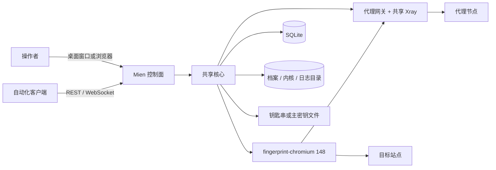
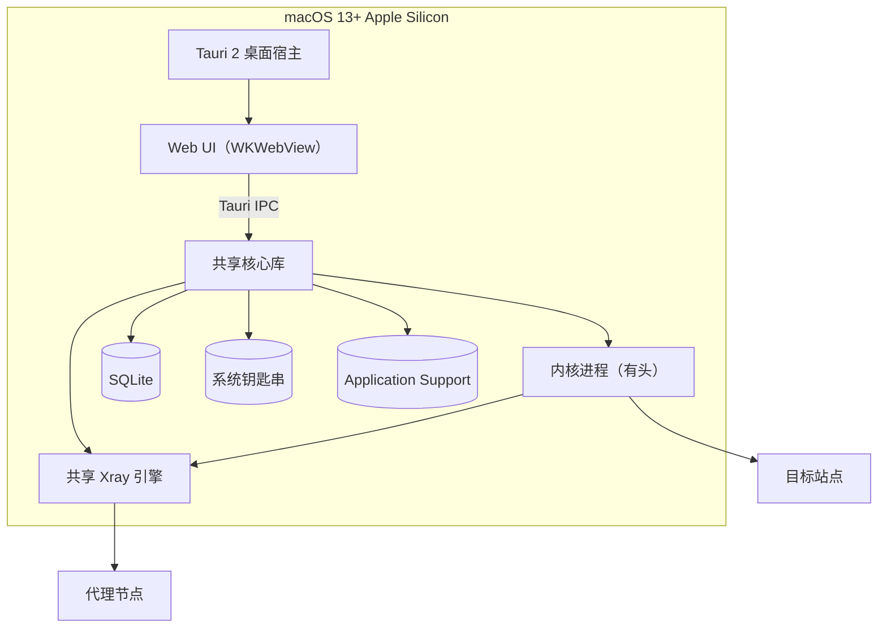
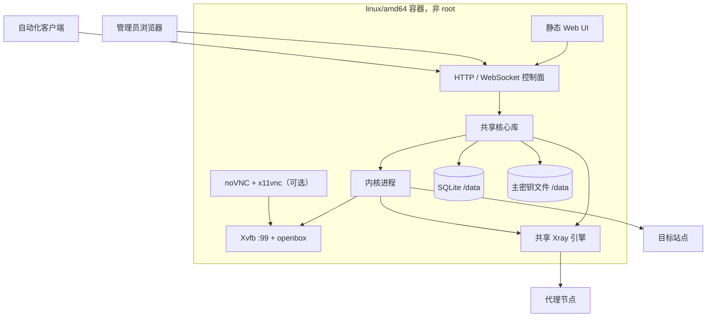
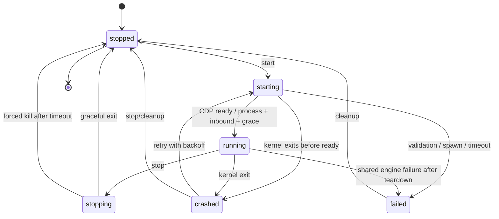
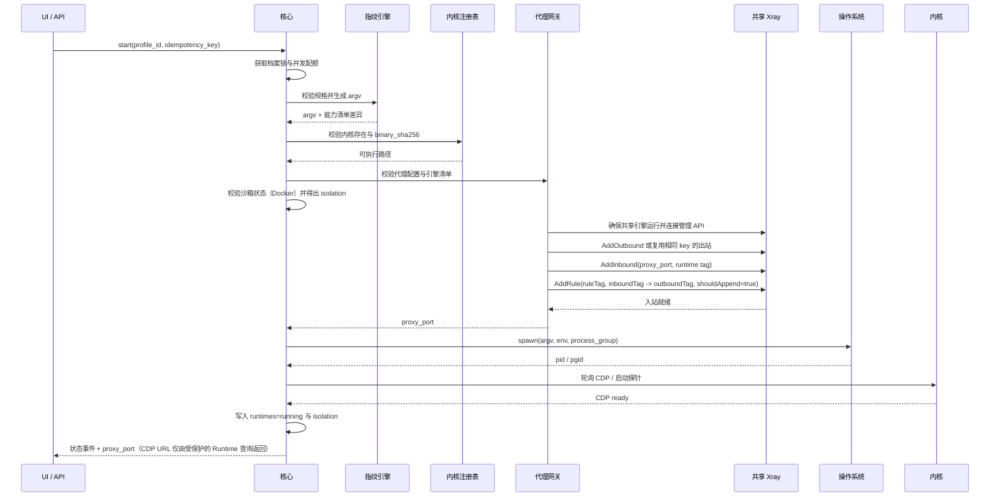
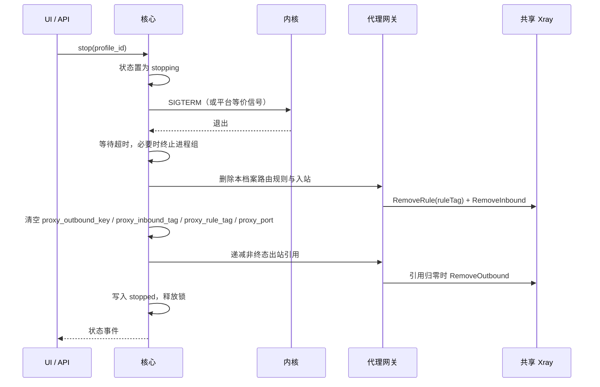
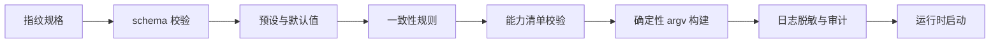
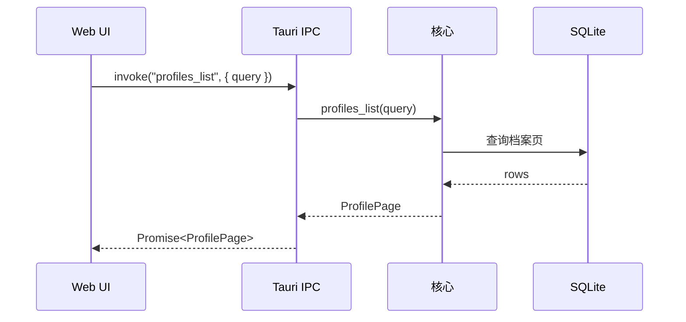

# Mien 架构设计

## 1. 目标与约束

本架构服务于同一套产品能力的两种交付形态：macOS Apple Silicon 桌面应用，以及无桌面环境的 Docker `linux/amd64` 服务。两种形态共享档案模型、指纹引擎、代理网关与协议引擎、内核管理、运行时监督和控制面语义，只在宿主集成、认证和显示环境上分化。

架构必须满足以下硬约束。

- 指纹内核固定为 fingerprint-chromium `148.0.7778.215`，不修改、不分叉，升级必须经过独立准入。
- 协议引擎固定为构建清单中的 Xray-core，每个宿主一个共享进程、不修改；安装时校验 `asset_sha256`，启动前校验可执行文件 `binary_sha256`；运行时通过只绑定回环的 Xray gRPC 管理 API 动态增删入站、出站与路由规则，升级必须经过协议矩阵准入。
- 每个档案独占浏览器数据目录、种子和运行时；档案之间不共享 Cookie、缓存或存储。
- Chromium 只连接所属运行档案的回环 HTTP 入站；VLESS、VMess、Shadowsocks、Trojan、Hysteria2 等协议与凭据由共享 Xray 引擎处理，产品不自行实现协议。
- Docker 默认有头运行，使用 Xvfb；无头与伪有头是显式降级选项。
- macOS 只支持 Apple Silicon；Docker 只支持 `linux/amd64`。
- 显示尺寸、设备像素比、颜色深度和字体枚举受宿主约束，架构必须让这些限制可观测，而不是假装可伪造。
- 控制面与运行时解耦；控制面崩溃或容器重启不能留下重复浏览器或损坏档案。

## 2. 系统上下文



系统边界内包含控制面、核心、内核进程、代理网关、共享 Xray 协议引擎、SQLite 和数据目录。系统边界外是操作者、自动化客户端、代理节点和目标站点。产品不销售代理服务，也不托管节点。

## 3. 运行拓扑

### 3.1 macOS 桌面



桌面宿主负责窗口、菜单、自动更新、单实例和系统钥匙串访问。浏览器进程作为宿主的子进程运行，使用宿主桌面显示。控制面不默认开放网络端口；自动化 API 需要用户显式启用并生成 Token，且绑定地址必须是 `127.0.0.1`/`::1`，非回环配置在启动时被拒绝而不是降级监听。

### 3.2 Docker 服务



容器内只有一个控制面进程、一个共享 Xray 引擎和一个共享 Xvfb。多个档案可以有头运行在同一虚拟显示上，通过不同窗口和用户数据目录隔离；网络层共享引擎，但每个运行档案有独立回环入站和路由；窗口尺寸由启动参数控制，屏幕尺寸由 Xvfb 启动参数统一决定。需要每档案独立分辨率时，后续版本可以引入每档案 Xvfb，首个发布不做。

### 3.3 端口与监听

| 组件 | 绑定 | 默认 | 说明 |
| --- | --- | --- | --- |
| 服务端控制面 | 容器内 `0.0.0.0:8080` | 开启 | 由部署者映射；必须置于认证之后 |
| 桌面自动化 API | `127.0.0.1` 随机端口 | 关闭 | 用户显式启用；Token 鉴权；绑定地址必须是回环，非回环配置在启动时拒绝 |
| 每运行档案 HTTP 入站 | `127.0.0.1` 固定分配端口 | 每个运行档案一个 | 不对外暴露；Chromium 只连接此处 |
| Xray gRPC 管理 API | `127.0.0.1` 随机端口 | 常驻 | 无应用层鉴权；同 UID 进程可调用（无沙箱时即包含内核 UID），残余风险见 SECURITY T-15/T-22；不映射到容器外 |
| CDP | `127.0.0.1` 随机端口 | 按档案启用 | 不对外暴露 |
| noVNC | 容器内 `0.0.0.0:6080` | 关闭 | 一次性令牌或独立认证 |
| Xvfb | 容器内 `:99` | 有头模式 | Unix socket，不监听 TCP |

## 4. 组件职责

| 组件 | 职责 | 不负责 |
| --- | --- | --- |
| `mien-core` | 档案、指纹规格、校验、内核注册、运行时监督、代理网关、存储端口与审计 | HTTP 会话、静态资源、系统窗口、具体数据库驱动 |
| 桌面宿主 | Tauri 命令、窗口、钥匙串、自动更新、单实例、崩溃上报 | 指纹算法、代理协议 |
| 服务端宿主 | HTTP/WS、登录、Token、静态 UI、健康检查、优雅关闭 | 指纹算法、内核启动细节 |
| Web UI | 档案管理、指纹编辑、代理配置、运行控制、日志与限制提示 | 直接启动内核、直接读取数据库 |
| 内核 | 浏览器渲染与指纹伪装 | 档案管理、代理协议、认证、进程监督 |
| 代理网关 | 代理配置校验、Xray gRPC 管理 API 调用、出站引用计数、入站/路由生命周期、失败关闭、健康事件 | 协议密码学、字节流转发、档案存储 |
| Xray 协议引擎 | VLESS、VMess、Shadowsocks、Trojan、Hysteria2 等协议、认证、TLS/REALITY/WS/gRPC/QUIC、出站 DNS、共享出站连接池 | 档案管理、UI、浏览器进程监督 |
| 显示监督 | Xvfb、openbox、x11vnc、noVNC 生命周期 | 浏览器进程监督 |
| 内核注册表 | 安装包 `asset_sha256` 与解包后 `binary_sha256` 校验、能力清单、版本选择、回滚 | 修改内核二进制 |
| 协议引擎注册表 | Xray-core 安装包 `asset_sha256` 与解包后 `binary_sha256` 校验、协议清单、版本选择、许可与回滚 | 修改引擎二进制 |

## 5. 代码组织

计划采用 Rust workspace 与独立前端目录，核心逻辑不依赖桌面或服务端框架。

```text
crates/
  mien-core/            # 领域模型、指纹、运行时、代理、内核、存储端口与用例
  mien-store-sqlite/    # mien-core 存储端口的 SQLite/sqlx 适配器
  mien-server/          # 服务端宿主：axum、认证、静态 UI、健康检查
  mien-desktop/         # Tauri 宿主、IPC、钥匙串、更新
  mien-cli/             # 本地诊断、迁移、内核准入辅助
xtask/                  # 仓库构建、校验、打包任务
ui/                     # React + TypeScript + Vite，桌面与服务端共用
contracts/              # JSON Schema（源文件位于 docs/contracts）
kernels/                # 构建时下载的校验清单，不提交二进制
engines/                # Xray-core 版本与校验清单，不提交二进制
deploy/
  docker/               # Dockerfile、入口脚本、Xvfb/openbox/noVNC 配置
docs/
```

`mien-core` 通过 trait 抽象平台差异：密钥提供者、进程启动器、显示环境、通知、文件权限与仓储。SQLite/sqlx 只出现在 `mien-store-sqlite`，领域层不依赖任何数据库驱动；桌面宿主和服务端宿主只实现宿主适配层并装配适配器，不复制业务逻辑。

## 6. 数据模型

SQLite 使用 WAL、外键和显式迁移。运行态以数据库记录为准，内存状态在启动时对账。

| 表 | 关键字段 | 说明 |
| --- | --- | --- |
| `profiles` | `id`, `name`, `group_id`, `notes`, `fingerprint_json`, `fingerprint_schema`, `kernel_version`, `proxy_id`, `runtime_json`, `status`, `created_at`, `updated_at`, `archived_at`, `deleted_at`, `deletion_error` | 档案本体；`id` 为 ULID；`status` 为 `active`/`archived`/`deleted`；目录删除失败时保留 `deleted` 并记录 `deletion_error` 供重试；窗口尺寸只存在于 `fingerprint_json`，不再有 `window_json` |
| `groups` | `id`, `name`, `sort_order` | 分组；名称在组内唯一 |
| `tags` | `id`, `name`, `color` | 标签；名称唯一 |
| `profile_tags` | `profile_id`, `tag_id` | 多对多；`idx_profile_tags_tag(tag_id)` 支撑按标签筛选 |
| `proxies` | `id`, `name`, `kind`, `server`, `port`, `config_ciphertext`, `last_check_json`, `created_at`, `updated_at` | 正向代理；`kind` 为 HTTP/SOCKS/VLESS/VMess/Shadowsocks/Trojan/Hysteria2/WireGuard；完整协议选项与凭据加密存储 |
| `runtimes` | `id`, `profile_id`, `state`, `mode`, `isolation`, `pid`, `pgid`, `proxy_port`, `proxy_inbound_tag`, `proxy_outbound_key`, `proxy_rule_tag`, `started_at`, `cdp_port`, `exit_code`, `last_error` | 运行态；`state` 为 stopped/starting/running/stopping/crashed/failed；`mode` 为 headful/headless/pseudo_headful；`isolation` 为 `enforced`/`unsandboxed`/`unknown`，驱动 proof strip；共享引擎按这些标签重建入站、出站和路由 |
| `kernel_installs` | `version`, `platform`, `path`, `asset_sha256`, `binary_sha256`, `manifest_json`, `active`, `installed_at` | 已安装内核；`asset_sha256` 是发布资产摘要，`binary_sha256` 是解包后可执行文件摘要，运行时只比对后者；支持并存与回滚 |
| `proxy_engine_installs` | `version`, `platform`, `path`, `asset_sha256`, `binary_sha256`, `manifest_json`, `license`, `source_url`, `active`, `installed_at` | 已安装 Xray-core；双哈希语义同内核；协议矩阵、许可与回滚 |
| `proxy_engine_state` | `pid`, `api_port`, `state`, `started_at`, `last_error` | 单实例引擎运行态；控制面启动时对账 |
| `proxy_outbounds` | `outbound_key`, `route_key_json`, `ref_count`, `created_at`, `updated_at` | 共享出站引用计数；`ref_count` 只统计非终态运行时；运行时停止时先清空 `runtimes.proxy_*` 再递减 |
| `api_tokens` | `id`, `name`, `token_hash`, `scopes`, `created_at`, `last_used_at`, `revoked_at` | 自动化 Token；只存哈希 |
| `sessions` | `id`, `token_hash`, `created_at`, `expires_at`, `last_used_at`, `revoked_at` | 服务端登录会话；Cookie 只存随机标识，库中只存哈希 |
| `admin_credentials` | `id`, `password_hash`, `algo`, `params_json`, `must_change`, `bootstrap_pending`, `updated_at` | 单管理员凭据（`id=1`）；Argon2id 参数版本化；首次登录强制改密，改密后清空引导标记并删除引导密码来源 |
| `event_log` | `sequence`, `event_id`, `type`, `payload_json`, `created_at` | WebSocket 事件回放；`sequence` 为自增整数游标，`event_id` 为外部去重标识；按保留策略清理 |
| `idempotency_keys` | `key`, `scope`, `request_hash`, `response_json`, `created_at`, `expires_at` | 写操作幂等；过期清理 |
| `audit_events` | `id`, `actor`, `action`, `event_type`, `profile_id`, `target`, `result`, `metadata_json`, `created_at` | 审计；`event_type`/`profile_id` 为筛选字段，`action` 保留兼容；元数据脱敏 |
| `settings` | `key`, `value_json`, `updated_at` | 全局设置；不存主密钥 |

档案生命周期：`active <-> archived` 由 archive/restore 驱动；`active|archived -> deleted` 由 `DELETE permanent=false` 驱动，目录移动到 `<data-root>/trash/<id>` 并写 `deleted_at`；`deleted -> active` 由 restore 驱动并清空 `archived_at`；`deleted -> purge` 由 `DELETE permanent=true` 驱动，先删除目录再删除行，目录删除失败则保留 `deleted` 并写 `deletion_error`。`deleted` 档案不能启动，也不能通过运行控制隐式恢复；启动返回 `PROFILE_DELETED`（409），已 purge 或从未存在的 ID 返回 `PROFILE_NOT_FOUND`（404）。

Profile 响应中的 `isolation` 派生自最近一次运行时的 `runtimes.isolation`；没有运行时记录时为 `unknown`。停止档案仍保留最后一次已知值，供 proof strip 区分“未运行”与“未知”。

数据目录布局：

```text
<data-root>/
  db/mien.db
  db/mien.db-wal
  kernels/<version>/<platform>/...
  engines/<version>/<platform>/...
  profiles/<profile-id>/chrome/
  profiles/<profile-id>/logs/
  profiles/<profile-id>/downloads/
  profiles/<profile-id>/meta.json
  trash/<profile-id>/        # 非永久删除的档案目录，可恢复
  secrets/master.key          # 仅服务端文件模式
  exports/
  runtimes/                   # 锁文件、临时代理配置与运行时元数据
```

macOS 的 `<data-root>` 为 `~/Library/Application Support/Mien`，日志位于 `~/Library/Logs/Mien`。Docker 的 `<data-root>` 固定为 `/data`，由卷持久化。

### 6.1 档案状态机



`starting` 期间任何一步失败都必须回滚：删除路由规则与入站、清空 `proxy_*` 字段、释放共享出站引用、终止已启动内核、释放档案锁、写回错误。共享引擎本身不因单个档案启动失败而退出。`stopping`/`starting` 在控制面重启后不保留中间态：终止可归属内核并清理资源后写 `stopped`，只有清理本身失败才写 `failed`。任何终态（`crashed`、`failed`、`stopped`）都不得留下仍在运行的内核或仍计数的代理资源。`crashed` 不自动无限重启；退避次数和窗口可配置。

## 7. 关键流程

### 7.1 启动档案



启动流程是串行的资源获取过程。先写入 `starting` 记录；沙箱校验必须发生在创建任何代理资源和启动内核之前：Docker 中无法确认沙箱生效时以 `SANDBOX_UNAVAILABLE` 拒绝，并以 `ALLOW_UNSANDBOXED=1` 作为唯一例外。通过后把 `isolation` 定为 `enforced`、`unsandboxed` 或 `unknown` 并持久化。代理模式在共享引擎就绪后创建出站、入站和路由，直接模式跳过这些资源并保留 DoH/IPv6/UDP 防护。每次增量建规则都带稳定 `ruleTag` 并使用 `shouldAppend=true`，使新规则追加在引导配置的 blackhole 之后。任何一步失败都回滚并返回稳定错误码。代理检查结果只是警告，不阻断启动；内核校验失败、引擎校验失败、沙箱不可用、代理配置无效、规格不一致、端口冲突或配额不足必须拒绝。`headless` 使用 `--headless=new`；`pseudo_headful` 还要求内核能力清单声明 `headless_chrome_ua_patch=true`，只改变 `HeadlessChrome` UA 为 `Chrome`，其他 Headless 特征仍保留。

### 7.2 停止档案



停止操作幂等。已经停止的档案再次停止返回成功，不报错。路由规则只按稳定 `ruleTag` 删除，不靠位置或全量重写。清理顺序固定为：终止进程 → 删除规则与入站 → 清空运行时的 `proxy_*` 字段 → 递减非终态引用计数；因此 `proxy_outbounds.ref_count` 只统计非终态运行时，不会因终态行残留而漂移。共享引擎不因单个档案停止而退出；只有引用归零的出站被删除。强制终止后必须记录事件，标记该次运行非正常结束。

### 7.3 控制面重启对账

1. 读取 `runtimes` 中非终态记录和 `proxy_engine_state`。
2. 检查共享 Xray 引擎 PID、进程启动时间和 API 端口是否匹配；检查各内核 PID 与数据目录。
3. 对 `starting`/`stopping` 这类中断行，终止可归属的内核进程组，删除对应入站与规则，清空 `proxy_*` 字段并递减非终态引用计数，然后写 `stopped`；只有 teardown 本身失败时才写 `failed`。
4. 共享引擎不存在或不可接管时，安全终止残留引擎并启动新实例，然后按 `proxy_port` 重建所有运行档案的出站、入站和路由规则；重建使用原 `ruleTag` 与 `shouldAppend=true`。
5. 共享引擎可接管时，通过 Xray gRPC 管理 API 列出出站/入站，补齐缺失配置并删除孤儿入站或规则；引擎报告的 `ruleTag` 是规则归属的唯一依据。
6. 不可确认归属的内核进程不得盲目杀死，记录隔离事件；按配置清理超时孤儿。
7. 清理过期锁文件、临时规则、残留调试端口；未完成操作在 teardown 完成后以 `stopped` 或 `failed` 告知 UI，不留中间态。

### 7.4 代理检查

代理检查通过共享引擎临时创建的回环入站、带 `ruleTag` 的临时路由规则和独立 `chk:<check_id>:out` 出站发起短连接，检查完成后按 `ruleTag` 立即删除临时资源；不启动第二个引擎，不写入 `proxy_outbounds`，不改变运行档案的 `ref_count`。检查内容包括协议握手、TLS/REALITY、认证、节点可达性、出口 IP、延迟和可选地区信息。检查结果写入 `proxies.last_check_json`，只是启动前展示的警告，产品不提供“检查失败禁止启动”选项。检查端点始终返回 200，网络与认证失败通过 `ProxyCheck.error_code` 和事件表达，不占用 HTTP 502。

## 8. 指纹流水线

指纹流水线把用户可编辑的规格转换为内核参数，并在每一步保留可诊断的中间结果。



### 8.1 规格字段

| 字段 | 来源 | 说明 |
| --- | --- | --- |
| `seed` | 用户或生成器 | 32 位非零整数；决定未显式暴露的派生特征 |
| `platform` | 用户 | `windows`、`macos`、`linux` |
| `platform_version` | 用户或预设 | 必须落在当前平台支持列表 |
| `brand` | 用户或预设 | `Chrome`、`Edge`、`Opera`、`Vivaldi` |
| `brand_version` | 用户或预设 | 不得高于内核主版本；与平台兼容 |
| `hardware_concurrency` | 用户或预设 | 受限集合，避免不现实的取值 |
| `languages` | 用户或预设 | 传给 `--lang` 与 `--accept-lang` |
| `timezone` | 用户或预设 | 传给 `--timezone` |
| `window` | 用户或预设 | 仅窗口尺寸；不是屏幕分辨率；档案窗口尺寸的唯一权威来源 |
| `spoof` | 用户 | 映射到 `--disable-spoofing`，仅支持能力清单声明的类别 |
| `webrtc` | 用户 | 默认禁止非代理 UDP |

屏幕尺寸、设备像素比、颜色深度和字体白名单不在规格中作为可伪造字段，因为当前内核不提供可靠支持。UI 可以显示宿主实际值，但不能让用户误以为这些值随档案变化。

窗口尺寸只在指纹规格中定义：`ProfileInput`/`ProfilePatch`/`Profile` 不再有顶层 `window`，启动偏好和导出运行时也不重复存储；内核清单以 `window-size` 声明该参数可用，启动时从规格读取。

### 8.2 一致性与降级

- 默认预设与宿主操作系统一致：macOS 宿主使用 macOS 画像，Docker 使用 Linux 画像，Windows 宿主使用 Windows 画像。
- 跨系统画像允许作为高级选项，但必须显示“字体、显示、图形栈可能泄漏宿主”的提示，并在档案详情中持久标记。
- 代理地区、时区与语言不一致时给出警告；用户确认后可以保存。
- 品牌版本不得高于内核主版本，避免 UA 与 UA-CH 声称一个内核不存在的版本。
- 种子派生特征不逐项存储；档案记录种子、内核版本和规格 schema，保证可复现。
- 同一档案在相同内核与规格下重复启动，探针结果必须一致。`copy_fingerprint=true` 复制显式字段但总是生成新种子，因此不存在种子冲突分支，也不以种子唯一性阻止保存。

### 8.3 能力清单

每个内核安装包附带机器可读能力清单，至少包含：

```json
{
  "kernel_version": "148.0.7778.215",
  "platform": "linux-x86_64",
  "sha256": "<vendored-at-build-time>",
  "flags": {
    "fingerprint": {"type": "uint32"},
    "fingerprint-platform": {"values": ["windows", "macos", "linux"]},
    "fingerprint-platform-version": {"type": "string"},
    "fingerprint-brand": {"values": ["Chrome", "Edge", "Opera", "Vivaldi"]},
    "fingerprint-brand-version": {"type": "string"},
    "fingerprint-hardware-concurrency": {"type": "integer"},
    "lang": {"type": "string"},
    "accept-lang": {"type": "string"},
    "timezone": {"type": "string"},
    "window-size": {"type": "string"},
    "proxy-server": {"type": "string"},
    "disable-non-proxied-udp": {"type": "boolean"},
    "disable-spoofing": {"values": ["font", "audio", "canvas", "clientrects", "gpu"]}
  },
  "seed_derived": ["canvas", "audio", "webgl", "device_memory", "gpu_model"],
  "known_issues": ["#98", "#99", "#102"],
  "headless_chrome_ua_patch": true,
  "sandbox_kind": "namespace",
  "network_controls": {"doh_mode": "disabled", "ipv6_mode": "block"}
}
```

清单是产品与内核之间的唯一能力来源。UI 不硬编码参数是否可用；规格校验和启动参数构建都读取清单。清单中的 `sandbox_kind` 取 `namespace`、`seatbelt`、`appcontainer` 或 `none`，替代早先的 `requires_namespace_sandbox` 布尔值；`flagSpec` 可以声明 `per_platform_values`，把 CPU、语言、时区等平台差异变成数据而不是代码分支；`network_controls` 允许能力缺失的清单用 `disabled|unsupported` 与 `block|unsupported` 表达真实情况。清单中的 `known_issues` 用于在 UI 显示风险提示和阻断不安全的自动升级。

协议引擎使用独立的能力清单，字段包括版本、平台、SHA-256、许可、协议、传输、TLS 模式和已知限制；契约见 `docs/contracts/proxy-engine-manifest.schema.json`。内核清单与引擎清单不得混用。

## 9. 控制面边界

控制面是 UI 与自动化客户端的唯一入口，不直接暴露数据库或内核进程控制。

| 方法 | 路径 | 用途 |
| --- | --- | --- |
| `POST` | `/api/v1/auth/login` | 服务端登录，创建会话 |
| `POST` | `/api/v1/auth/logout` | 销毁会话 |
| `GET` | `/api/v1/auth/session` | 当前会话与改密标记 |
| `POST` | `/api/v1/auth/password` | 首次登录或用户主动改密 |
| `GET` | `/api/v1/profiles` | 分页、筛选、搜索档案 |
| `POST` | `/api/v1/profiles` | 创建档案 |
| `GET` | `/api/v1/profiles/{id}` | 档案详情 |
| `PATCH` | `/api/v1/profiles/{id}` | 更新档案 |
| `DELETE` | `/api/v1/profiles/{id}` | 归档或删除 |
| `POST` | `/api/v1/profiles/{id}/duplicate` | 复制档案 |
| `POST` | `/api/v1/profiles/{id}/archive` | 归档档案 |
| `POST` | `/api/v1/profiles/{id}/restore` | 恢复档案 |
| `POST` | `/api/v1/profiles/import` | 导入档案 |
| `POST` | `/api/v1/profiles/import/validate` | 导入 dry-run：返回逐项草稿、错误与冲突，不写库 |
| `POST` | `/api/v1/profiles/{id}/export` | 导出档案；请求体选择明文或加密（`format`、`passphrase`） |
| `POST` | `/api/v1/profiles/{id}/start` | 启动运行时 |
| `POST` | `/api/v1/profiles/{id}/stop` | 停止运行时 |
| `GET` | `/api/v1/profiles/{id}/runtime` | 运行时详情 |
| `GET` | `/api/v1/profiles/{id}/logs` | 有界、脱敏的运行时日志尾部 |
| `POST` | `/api/v1/profiles/{id}/viewer` | 一次性查看器 URL |
| `GET` | `/api/v1/groups` | 分组列表 |
| `POST` | `/api/v1/groups` | 创建分组 |
| `PATCH` | `/api/v1/groups/{id}` | 更新分组 |
| `DELETE` | `/api/v1/groups/{id}` | 删除分组 |
| `GET` | `/api/v1/tags` | 标签列表 |
| `POST` | `/api/v1/tags` | 创建标签 |
| `PATCH` | `/api/v1/tags/{id}` | 更新标签 |
| `DELETE` | `/api/v1/tags/{id}` | 删除标签 |
| `GET` | `/api/v1/proxies` | 代理列表（脱敏） |
| `POST` | `/api/v1/proxies` | 创建代理配置 |
| `PATCH` | `/api/v1/proxies/{id}` | 更新代理配置 |
| `DELETE` | `/api/v1/proxies/{id}` | 删除代理配置 |
| `POST` | `/api/v1/proxies/import-link` | 导入单条分享链接 |
| `POST` | `/api/v1/proxies/{id}/check` | 通过协议引擎测试代理 |
| `GET` | `/api/v1/kernels` | 已安装内核与能力清单 |
| `POST` | `/api/v1/kernels/{version}/activate` | 切换默认内核 |
| `GET` | `/api/v1/engines` | 已安装协议引擎与能力清单 |
| `POST` | `/api/v1/engines/{version}/activate` | 切换默认协议引擎 |
| `GET` | `/api/v1/tokens` | Token 列表 |
| `POST` | `/api/v1/tokens` | 创建 Token |
| `DELETE` | `/api/v1/tokens/{id}` | 撤销 Token |
| `GET` | `/api/v1/audit/events` | 审计事件 |
| `POST` | `/api/v1/events/ticket` | 申请一次性 WebSocket 票据 |
| `GET` | `/api/v1/events` | WebSocket 事件流 |
| `GET` | `/api/v1/openapi.json` | 运行时 OpenAPI 文档 |
| `GET` | `/healthz` | 存活检查 |
| `GET` | `/readyz` | 就绪检查 |

完整契约见 [`specs/control-api/SPEC.md`](specs/control-api/SPEC.md)。API 使用统一错误结构、请求标识和稳定错误码；默认所有操作都需要认证，只有 `/healthz`、`/readyz`、`/api/v1` 发现、`/api/v1/auth/login` 与 `/api/v1/openapi.json` 公开。写操作校验会话、CSRF 和来源，Token 使用范围化权限；受保护操作声明 401/403，指向既有资源的操作声明 404。

### 9.1 桌面 IPC 与 HTTP 控制面

桌面与服务端共用同一套 Web UI，但传输不同：

- 服务端：Web UI 同源调用 `/api/v1` 与 `/api/v1/events`。
- 桌面：Web UI 通过 Tauri IPC 调用 Rust 命令，核心用例在进程内执行；不为管理 UI 启动本地 HTTP 控制面。
- 桌面自动化 API：独立可选能力，显式开启后只绑定回环、使用 Bearer Token；与管理 UI 的 IPC 通道分离。



UI 通过 `ControlTransport` 抽象选择 Tauri 或 HTTP 适配器；命令、DTO、错误与事件结构保持一致。详细调用链、事件回放和文件对话框约束见 [`DESIGN.md`](DESIGN.md) 与 [`ADR-0008`](adr/0008-tauri-ipc-ui-transport.md)。

## 10. 安全架构

### 10.1 信任边界

- 浏览器渲染进程运行不可信网页，必须假定其可被攻击。
- 代理配置、分享链接和导入文件是外部输入，必须校验。
- 服务端控制面暴露在网络上，必须认证、限流和防 CSRF。
- CDP、noVNC 和 Xray gRPC 管理 API 是高权限入口，默认只绑定回环或关闭；回环不是调用者身份，Xray API 的同 UID 可达性按 SECURITY T-15/T-22 接受，无沙箱模式额外要求网络边界（见 §10.3）。
- 内核与协议引擎二进制是供应链输入，必须校验和版本绑定。

### 10.2 关键控制

| 区域 | 控制 |
| --- | --- |
| 认证 | 服务端会话 Cookie `HttpOnly`、`SameSite=Strict`；服务端模式恒为 `Secure`；API Token 只存哈希；登录限流；管理员凭据存 `admin_credentials`（Argon2id），由 `MIEN_ADMIN_PASSWORD` 或 `MIEN_ADMIN_PASSWORD_FILE` 引导，两者都未提供时生成高熵密码写入 `/data/secrets/admin-bootstrap`（0600）；首次登录强制改密，改密后删除引导来源。 |
| 授权 | v1 使用管理员与 Token 范围；所有写操作检查档案归属和 Token scope。 |
| 密钥 | 桌面使用系统钥匙串；服务端使用 `/data/secrets/master.key`（0600）或 `MIEN_MASTER_KEY`；字段级 AES-256-GCM；API Token 从不使用 AES-GCM，只用 HKDF-peppered 哈希，主密钥轮换使全部 Token 失效并要求重发。 |
| 进程 | 参数数组启动，不经过 shell；进程组管理；档案锁；并发配额；子进程 `env_clear` 后只注入白名单变量。 |
| 文件 | 档案目录 0700；路径规范化并校验前缀；导入文件大小限制；符号链接拒绝。 |
| 网络 | 每运行档案 HTTP 入站、Xray gRPC 管理 API 与 CDP 都绑定回环，但回环只限制可达范围、不提供调用者鉴权；服务端默认只允许认证流量；仅当来源在 `MIEN_TRUSTED_PROXIES` 中时才采信 `X-Forwarded-For`/`X-Forwarded-Proto`，限流按校验后的客户端 IP；noVNC 一次性令牌；容器网络最小化。 |
| 内核 | 安装时校验 `asset_sha256`，启动时校验可执行文件的 `binary_sha256`；能力清单；版本固定；沙箱状态检查；不允许静默升级。 |
| 协议引擎 | Xray-core 单实例共享进程；安装时校验 `asset_sha256`，启动时校验 `binary_sha256`；协议能力清单；管理 API 只绑定回环；凭据不写日志；MPL-2.0 许可与来源信息。 |
| 容器 | 非 root；只读根文件系统；强制 seccomp 配置（随发布物交付，非“按需”）；`--tmpfs /tmp:rw,noexec,nosuid,size=1g`；`/dev/shm` 显式定量；HOME/XDG 可写目录位于 `/data`；丢弃能力；`no-new-privileges`；镜像扫描；不使用 Docker socket。 |
| 日志 | 密码、Token、Cookie、UUID、私钥、完整代理 URL、分享链接和敏感头脱敏；有界且有长度上限的日志尾部端点；审计事件独立保留。 |

### 10.3 沙箱策略

Docker 中有头、无头或伪有头启动前必须检测 Chromium 沙箱是否生效，并把结果写入运行时的 `isolation`。命名空间沙箱依赖一个专用 seccomp 配置：它允许非特权用户命名空间（`clone`/`unshare` 所需最小集合），路径和 allowlist 是 M0 交付物与发布制品，必须随镜像、SBOM 和许可清单一同交付；文档不得把它描述为“按需”。Docker 无法提供清单声明的 `sandbox_kind`（当前为 `namespace`）时默认拒绝启动；只有显式设置 `ALLOW_UNSANDBOXED=1` 并记录审计事件后才允许 `--no-sandbox`，此时 `isolation=unsandboxed`。无法完成探测且未显式开启时不得猜测为安全，只能拒绝。桌面使用宿主原生沙箱（`seatbelt` 或 `appcontainer`）；无法确认时不阻断启动，但必须写 `isolation=unsandboxed` 或 `unknown` 并呈现降低保证。已知内核 148 存在渲染进程越界访问报告（#98/#99），无沙箱运行会显著放大影响。

## 11. 失败处理

| 失败 | 行为 |
| --- | --- |
| 内核文件缺失 | 拒绝启动，返回 `KERNEL_NOT_FOUND`，不创建该档案的入站/路由。 |
| 内核 `binary_sha256` 不符 | 拒绝启动，返回 `KERNEL_CHECKSUM_MISMATCH`，状态 `failed`，不创建该档案的入站/路由。 |
| 指纹规格与能力清单不符 | 拒绝启动，返回具体字段和原因。 |
| 代理配置无效或引擎校验失败 | 拒绝启动，释放配额，保留档案数据。 |
| 共享引擎启动或 API 就绪失败 | 拒绝启动新档案，返回稳定错误；已运行档案按引擎故障策略处理。 |
| 内核启动后立即退出 | 状态 `crashed`；由唯一 teardown 例程删除该档案的路由与入站并释放共享出站引用（恰好一次），记录退出码与日志尾部，按退避策略决定是否允许重试；共享引擎继续服务其他档案。 |
| 沙箱状态无法确认 | 代理资源创建与进程启动前拒绝，返回 `SANDBOX_UNAVAILABLE`；`ALLOW_UNSANDBOXED=1` 时继续但写 `isolation=unsandboxed` 与审计事件。 |
| 共享引擎运行中退出 | 所有运行档案网络失败，不发直连回退；记录 `proxy.engine.failed`，按有界退避重启并按原端口重建；重建失败时对每个受影响运行时执行 teardown（终止内核进程组、按 `ruleTag` 删规则与入站、释放出站引用、释放配额与锁），完成后才写 `failed`；不得在终态背后留下活内核或计入引用计数的资源。 |
| CDP 在超时内未就绪 | 终止内核进程组，删除该档案的路由与入站，状态 `failed`。 |
| 内核在 `starting` 期间提前退出 | 状态 `crashed`；执行同一 teardown 例程后再允许按退避重试。 |
| 控制面崩溃 | 内核与共享引擎可能成为孤儿；下次启动对账，确认引擎归属后接管并重建或清理入站/规则；非终态 `starting`/`stopping` 行先终止可归属内核并清理资源，再写 `stopped`（teardown 失败才写 `failed`）。 |
| 数据库锁定 | 短重试后返回可重试错误；迁移使用单写者。 |
| Xvfb 不可用 | 有头启动失败；无头模式仍可用，但 UI 明确提示。 |
| noVNC 不可用 | 不影响浏览器运行；查看器入口显示不可用。 |
| 代理节点不可用 | 浏览器网络失败，不回退直连；UI 显示代理检查状态。 |
| 主密钥丢失 | 已加密字段不可读；不自动清空，要求恢复密钥或执行显式重置流程。 |
| 磁盘空间不足 | 启动前检查；拒绝启动并提示清理日志、旧内核或档案数据。 |

## 12. 技术选型

| 层 | 选型 | 理由 |
| --- | --- | --- |
| 核心与服务端 | Rust stable、Tokio、axum、serde、tracing | 单二进制、强类型、可靠的进程与网络控制 |
| 存储 | SQLite + sqlx，WAL、外键、迁移 | 本地优先、无需额外服务、易备份 |
| 加密 | AES-256-GCM、Argon2id、HKDF、系统钥匙串 | 字段级认证加密、口令派生与 Token 哈希 |
| 桌面 | Tauri 2 + WKWebView | 体积小、原生进程控制、macOS 集成好 |
| Web UI | React + TypeScript + Vite + TanStack Query | 桌面与服务端共用，生态成熟 |
| 协议引擎 | Xray-core v26.11.9+，固定版本、双哈希（`asset_sha256`/`binary_sha256`）、能力清单 | 单实例动态入站/出站/路由；覆盖 VLESS、VMess、Shadowsocks、Trojan、Hysteria2、WireGuard；MPL-2.0 |
| 容器 | Debian slim、tini、Xvfb、openbox、x11vnc、noVNC | 无桌面环境下提供有头浏览与可选查看；tini 负责 PID 1 信号与回收 |
| CI | GitHub Actions macOS arm64 + linux/amd64 | 原生平台构建、AdHoc 打包、镜像发布 |

不选 Electron 的原因：桌面端会再次捆绑 Chromium，体积和内存开销大，且与指纹内核的进程管理没有直接收益。不选“桌面端调用远程服务”的原因：本地优先要求离线可用，且 macOS 用户不应被迫部署容器。

完整的选型矩阵、替代方案、版本策略与许可处理见 [`TECH-STACK.md`](TECH-STACK.md)；模块接口、启动/停止事务、并发、错误、配置、存储和部署契约见 [`DESIGN.md`](DESIGN.md)。

## 13. 构建与发布

### 13.1 内核供应

- 构建时从固定 URL 下载 fingerprint-chromium 发行包，对下载资产校验 `asset_sha256`，解包后对可执行文件计算 `binary_sha256`，两者一起写入安装记录与 `kernels/<version>/manifest.json`。
- 二进制不提交到 Git；构建缓存与发布物包含内核和 BSD-3-Clause 许可声明。
- macOS 应用将内核放入应用资源目录，随应用一起做 AdHoc 签名；首次启动解压到 Application Support 并再次校验。
- Docker 镜像在构建阶段安装 Linux 内核到 `/opt/mien/kernel`，镜像内再次校验。
- 内核升级通过独立发行物或镜像标签交付，不通过静默后台下载。

### 13.2 协议引擎供应

- 构建时从固定 URL 下载 Xray-core 发行包，分别记录 `asset_sha256` 与解包后 `binary_sha256`，同时记录版本、平台、协议矩阵、许可和来源信息；运行时只比对 `binary_sha256`。
- 引擎不提交到 Git；macOS 应用与 Docker 镜像均包含未修改的二进制、MPL-2.0 许可证与来源信息。
- 引擎启动时使用最小引导配置，其中 blackhole 必须是第一个出站；启动时断言该顺序，失败关闭不依赖不存在的 `routing.final`。代理出站、每档案回环 HTTP 入站和路由规则通过仅绑定回环的 Xray gRPC 管理 API 动态创建，每条规则带稳定 `ruleTag`，增量 `AddRule` 使用 `shouldAppend=true`，删除按 `ruleTag` 进行。
- 引擎版本轴独立于应用和内核，升级前比对能力清单并跑协议矩阵；引擎随应用/镜像交付，不做运行中原地替换；运行中的档案不被静默替换，升级会重置共享连接池。
- TUIC 不进入 v1；Hysteria2 依赖锁定版本中的 Xray 实现，并在发布准入中验证。

### 13.3 macOS

- 通用构建目标为 `aarch64-apple-darwin`，最低 macOS 13。
- 应用、嵌套内核、Xray-core 二进制和 frameworks 使用 AdHoc 签名；不执行公证，也不把 Gatekeeper 通过作为发布门禁。AdHoc 只提供包完整性信号，不证明发布者身份。
- 发布物提供 SHA-256SUMS、SBOM、许可证和 Tauri 更新清单；仓库计划支持时生成 GitHub artifact attestation。Gatekeeper 首次启动会阻止 AdHoc 应用，发布说明要求用户先校验资产，再手动放行。
- 自动更新使用 Tauri 更新签名清单，和 Apple 代码签名无关；禁止降级到未签名版本。
- CI 与发布 workflow 的触发、权限、制品和门禁见 [`CI.md`](CI.md) 与 [`ADR-0010`](adr/0010-adhoc-macos-distribution.md)。
- 主密钥存入登录钥匙串；卸载不自动删除数据目录。

### 13.4 Docker

- 多阶段构建：前端静态资源、Rust 服务端、运行时依赖。
- 运行用户为非 root；根文件系统只读；`/data` 是唯一持久可写卷，HOME/XDG 可写目录也映射在 `/data` 下；/tmp 使用 `--tmpfs /tmp:rw,noexec,nosuid,size=1g`，`/dev/shm` 显式定量。
- 容器必须加载随发布物交付的 Chromium 沙箱 seccomp 配置（允许非特权用户命名空间的最小 allowlist）；不得退化为“按需”或无 seccomp 默认。
- 管理员密码通过 `MIEN_ADMIN_PASSWORD` 或 `MIEN_ADMIN_PASSWORD_FILE` 引导，两者都未提供时生成高熵密码写入 `/data/secrets/admin-bootstrap`（0600）；首次登录强制改密，改密后删除引导来源；不得把初始密码写入镜像层或日志。
- 每档案下载目录固定为 `/data/profiles/<id>/downloads`（0700），并作为 Chromium 默认下载目录。
- 入口脚本负责 Xvfb、openbox、可选 noVNC 和主进程信号转发。
- 健康检查调用 `/healthz`；就绪检查验证数据库、内核和协议引擎可用，并在当前运行模式需要显示时检查显示环境。
- 镜像发布 `linux/amd64`；Apple Silicon 通过模拟运行，文档标注性能影响。
- 镜像扫描、SBOM、MPL-2.0 许可与来源信息进入发布门禁。

## 14. 可观测性

- 结构化日志字段：`ts`、`level`、`request_id`、`profile_id`、`runtime_id`、`event`、`error_code`、`isolation`。
- 启动失败返回稳定错误码，例如 `KERNEL_NOT_FOUND`、`KERNEL_CHECKSUM_MISMATCH`、`FINGERPRINT_INVALID`、`PROXY_ENGINE_NOT_FOUND`、`PROXY_ENGINE_CHECKSUM_MISMATCH`、`PROXY_ENGINE_API_UNAVAILABLE`、`PROXY_INBOUND_CONFLICT`、`PROXY_CONFIG_INVALID`、`SANDBOX_UNAVAILABLE`、`RUNTIME_CDP_TIMEOUT`、`QUOTA_EXCEEDED`。
- 运行时事件通过 WebSocket 推送：`runtime.starting`、`runtime.running`、`runtime.stopping`、`runtime.stopped`、`runtime.crashed`、`runtime.failed`、`proxy.engine.failed`、`proxy.engine.rebuilt`、`proxy.check.completed`。
- 指标：启动次数、成功率、启动耗时、运行档案数、代理检查失败率、崩溃次数。
- 日志轮转按档案和总量限制；默认保留最近 7 天或 100 MB，取较小者。

## 15. 测试策略

架构把可测试边界放在核心库：指纹规格到 argv 的纯函数、代理配置到出站/入站/路由的映射、共享引擎生命周期与引用计数、运行时状态机、存储迁移和 API 契约都可以在没有真实浏览器的情况下测试。真实内核与协议矩阵通过内核准入和端到端探针验证。完整矩阵见 [`TEST-PLAN.md`](TEST-PLAN.md)。

## 16. 相关决策

- [`ADR-0001`](adr/0001-shared-core-two-hosts.md)：共享核心与双宿主。
- [`ADR-0002`](adr/0002-pin-kernel-148.md)：固定内核 148 与准入策略。
- [`ADR-0003`](adr/0003-storage-and-secret-protection.md)：SQLite 与密钥保护。
- [`ADR-0004`](adr/0004-local-proxy-relay.md)：本地代理中继（历史背景，已被 ADR-0007 与 ADR-0009 取代）。
- [`ADR-0005`](adr/0005-headful-first-display.md)：有头优先与 Xvfb。
- [`ADR-0006`](adr/0006-fingerprint-spec-model.md)：指纹规格模型。
- [`ADR-0007`](adr/0007-protocol-engine-forward-proxy.md)：每档案独立协议引擎（已被 ADR-0009 取代）。
- [`ADR-0008`](adr/0008-tauri-ipc-ui-transport.md)：管理网页通过 Tauri IPC 调用核心。
- [`ADR-0009`](adr/0009-shared-xray-engine.md)：单实例 Xray 动态协议引擎与连接复用。

## 17. 参考

- [`PRD.md`](PRD.md)
- [`ROADMAP.md`](ROADMAP.md)
- [`TEST-PLAN.md`](TEST-PLAN.md)
- [`SECURITY.md`](SECURITY.md)
- [`DESIGN.md`](DESIGN.md)
- [`TECH-STACK.md`](TECH-STACK.md)
- [`specs/`](specs/)
- [`contracts/`](contracts/)
- [`DATABASE-SCHEMA.md`](DATABASE-SCHEMA.md)
- [`XRAY-MAPPING.md`](XRAY-MAPPING.md)
- [`ERROR-CODES.md`](ERROR-CODES.md)
- [`CI.md`](CI.md)
- [`adr/0010-adhoc-macos-distribution.md`](adr/0010-adhoc-macos-distribution.md)
