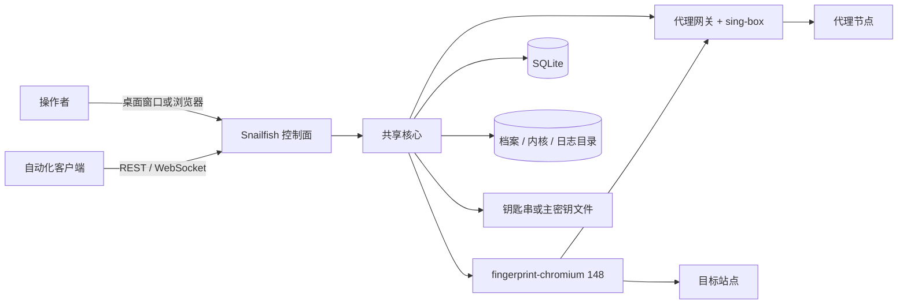
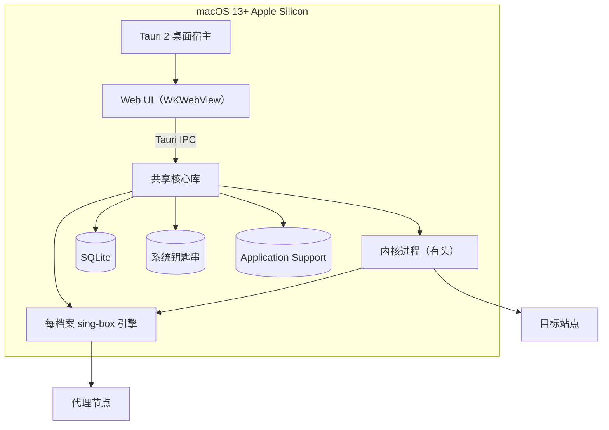
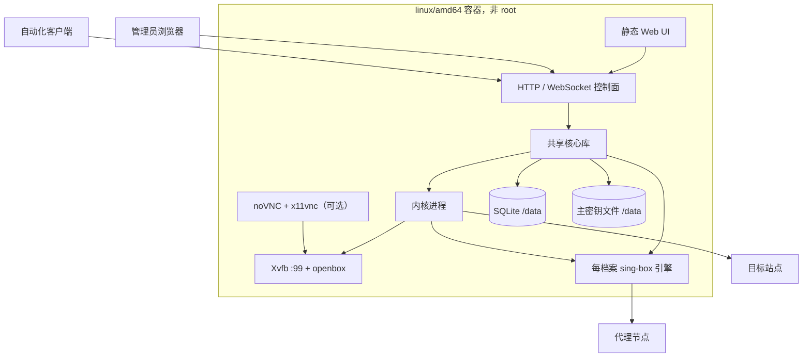
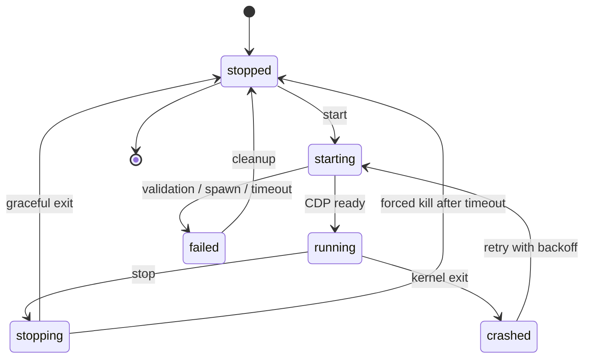
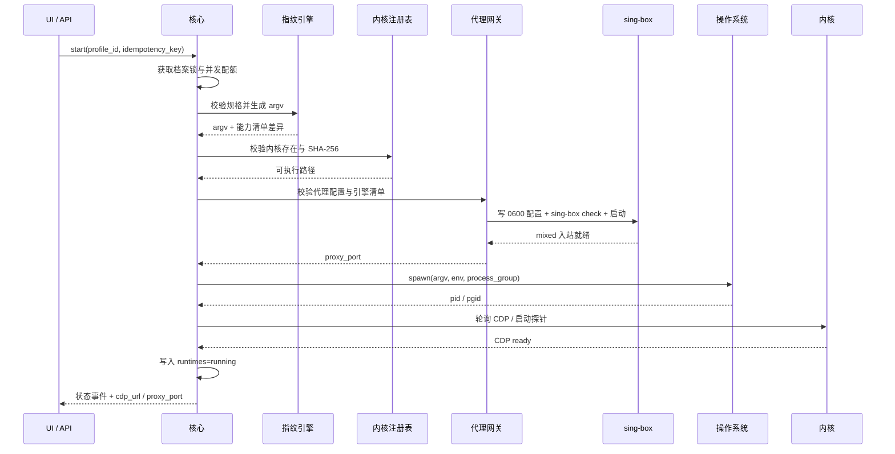
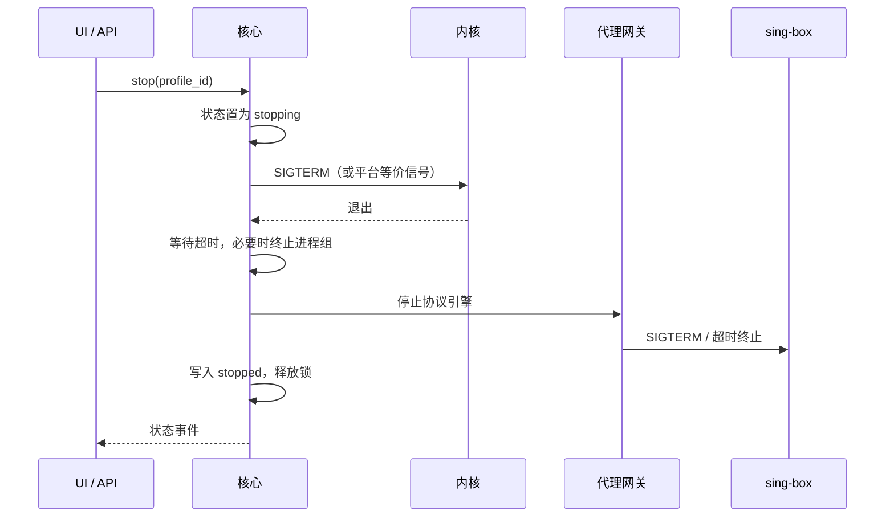
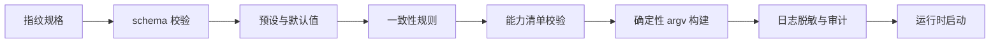

# Snailfish 架构设计

## 1. 目标与约束

本架构服务于同一套产品能力的两种交付形态：macOS Apple Silicon 桌面应用，以及无桌面环境的 Docker `linux/amd64` 服务。两种形态共享档案模型、指纹引擎、代理网关与协议引擎、内核管理、运行时监督和控制面语义，只在宿主集成、认证和显示环境上分化。

架构必须满足以下硬约束。

- 指纹内核固定为 fingerprint-chromium `148.0.7778.215`，不修改、不分叉，升级必须经过独立准入。
- 协议引擎首选固定为构建清单中的 sing-box 1.14.x，独立进程、不修改、校验 SHA-256；升级必须经过协议矩阵准入与 GPL 合规评审。若 GPL 评审不通过，按 ADR-0007 切换到 Xray-core 并更新能力清单。
- 每个档案独占浏览器数据目录、种子和运行时；档案之间不共享 Cookie、缓存或存储。
- Chromium 只连接本地协议引擎的 mixed 入口；VLESS、VMess、Shadowsocks、Trojan、Hysteria2 等协议与凭据由协议引擎（默认 sing-box）处理，产品不自行实现协议。
- Docker 默认有头运行，使用 Xvfb；无头是显式降级选项。
- macOS 只支持 Apple Silicon；Docker 只支持 `linux/amd64`。
- 显示尺寸、设备像素比、颜色深度和字体枚举受宿主约束，架构必须让这些限制可观测，而不是假装可伪造。
- 控制面与运行时解耦；控制面崩溃或容器重启不能留下重复浏览器或损坏档案。

## 2. 系统上下文



系统边界内包含控制面、核心、内核进程、代理网关、sing-box 协议引擎、SQLite 和数据目录。系统边界外是操作者、自动化客户端、代理节点和目标站点。产品不销售代理服务，也不托管节点。

## 3. 运行拓扑

### 3.1 macOS 桌面



桌面宿主负责窗口、菜单、自动更新、单实例和系统钥匙串访问。浏览器进程作为宿主的子进程运行，使用宿主桌面显示。控制面不默认开放网络端口；自动化 API 需要用户显式启用并生成 Token。

### 3.2 Docker 服务



容器内只有一个控制面进程和一个共享 Xvfb。多个档案可以有头运行在同一虚拟显示上，通过不同窗口和用户数据目录隔离；窗口尺寸由启动参数控制，屏幕尺寸由 Xvfb 启动参数统一决定。需要每档案独立分辨率时，后续版本可以引入每档案 Xvfb，首个发布不做。

### 3.3 端口与监听

| 组件 | 绑定 | 默认 | 说明 |
| --- | --- | --- | --- |
| 服务端控制面 | 容器内 `0.0.0.0:8080` | 开启 | 由部署者映射；必须置于认证之后 |
| 桌面自动化 API | `127.0.0.1` 随机端口 | 关闭 | 用户显式启用；Token 鉴权 |
| 协议引擎 mixed 入站 | `127.0.0.1` 随机端口 | 每运行档案一个 | 不对外暴露；Chromium 只连接此处 |
| CDP | `127.0.0.1` 随机端口 | 按档案启用 | 不对外暴露 |
| noVNC | 容器内 `0.0.0.0:6080` | 关闭 | 一次性令牌或独立认证 |
| Xvfb | 容器内 `:99` | 有头模式 | Unix socket，不监听 TCP |

## 4. 组件职责

| 组件 | 职责 | 不负责 |
| --- | --- | --- |
| `snailfish-core` | 档案、指纹规格、校验、内核注册、运行时监督、代理网关、存储、审计 | HTTP 会话、静态资源、系统窗口 |
| 桌面宿主 | Tauri 命令、窗口、钥匙串、自动更新、单实例、崩溃上报 | 指纹算法、代理协议 |
| 服务端宿主 | HTTP/WS、登录、Token、静态 UI、健康检查、优雅关闭 | 指纹算法、内核启动细节 |
| Web UI | 档案管理、指纹编辑、代理配置、运行控制、日志与限制提示 | 直接启动内核、直接读取数据库 |
| 内核 | 浏览器渲染与指纹伪装 | 档案管理、代理协议、认证、进程监督 |
| 代理网关 | 代理配置校验、引擎配置生成、启动/停止、就绪探测、失败关闭、健康事件 | 协议密码学、字节流转发、档案存储 |
| sing-box 协议引擎 | VLESS、VMess、Shadowsocks、Trojan、Hysteria2 等协议、认证、TLS/REALITY/WS/gRPC/QUIC、出站 DNS | 档案管理、UI、浏览器进程监督 |
| 显示监督 | Xvfb、openbox、x11vnc、noVNC 生命周期 | 浏览器进程监督 |
| 内核注册表 | 安装包校验、能力清单、版本选择、回滚 | 修改内核二进制 |
| 协议引擎注册表 | sing-box 安装包校验、协议清单、版本选择、许可与回滚 | 修改引擎二进制 |

## 5. 代码组织

计划采用 Rust workspace 与独立前端目录，核心逻辑不依赖桌面或服务端框架。

```text
crates/
  snailfish-core/       # 领域模型、存储、指纹、运行时、代理、内核
  snailfish-server/     # 服务端宿主：axum、认证、静态 UI、健康检查
  snailfish-desktop/    # Tauri 宿主、IPC、钥匙串、更新
  snailfish-cli/        # 本地诊断、迁移、内核准入辅助
xtask/                  # 仓库构建、校验、打包任务
ui/                     # React + TypeScript + Vite，桌面与服务端共用
contracts/              # JSON Schema（源文件位于 docs/contracts）
kernels/                # 构建时下载的校验清单，不提交二进制
engines/                # sing-box 版本与校验清单，不提交二进制
deploy/
  docker/               # Dockerfile、入口脚本、Xvfb/openbox/noVNC 配置
docs/
```

`snailfish-core` 通过 trait 抽象平台差异：密钥提供者、进程启动器、显示环境、通知与文件权限。桌面宿主和服务端宿主只实现宿主适配层，不复制业务逻辑。

## 6. 数据模型

SQLite 使用 WAL、外键和显式迁移。运行态以数据库记录为准，内存状态在启动时对账。

| 表 | 关键字段 | 说明 |
| --- | --- | --- |
| `profiles` | `id`, `name`, `group_id`, `notes`, `fingerprint_json`, `fingerprint_schema`, `kernel_version`, `proxy_id`, `runtime_json`, `status`, `created_at`, `updated_at`, `deleted_at` | 档案本体；`id` 为 ULID；软删除保留恢复窗口 |
| `groups` | `id`, `name`, `sort_order` | 分组；名称在组内唯一 |
| `tags` | `id`, `name`, `color` | 标签；名称唯一 |
| `profile_tags` | `profile_id`, `tag_id` | 多对多 |
| `proxies` | `id`, `name`, `kind`, `server`, `port`, `config_ciphertext`, `last_check_json`, `created_at`, `updated_at` | 正向代理；`kind` 为 HTTP/SOCKS/VLESS/VMess/Shadowsocks/Trojan/Hysteria2 等；完整协议选项与凭据加密存储 |
| `runtimes` | `id`, `profile_id`, `state`, `pid`, `pgid`, `engine_pid`, `started_at`, `cdp_port`, `proxy_port`, `exit_code`, `last_error` | 运行态；控制面启动时对账内核与引擎进程 |
| `kernel_installs` | `version`, `platform`, `path`, `sha256`, `manifest_json`, `installed_at` | 已安装内核；支持并存与回滚 |
| `proxy_engine_installs` | `version`, `platform`, `path`, `sha256`, `manifest_json`, `license`, `source_url`, `installed_at` | 已安装 sing-box；协议矩阵、许可与回滚 |
| `api_tokens` | `id`, `name`, `token_hash`, `scopes`, `created_at`, `last_used_at`, `revoked_at` | 自动化 Token；只存哈希 |
| `sessions` | `id`, `token_hash`, `created_at`, `expires_at`, `last_used_at`, `revoked_at` | 服务端登录会话；Cookie 只存随机标识，库中只存哈希 |
| `event_log` | `id`, `type`, `payload_json`, `created_at` | WebSocket 事件回放；按保留策略清理 |
| `idempotency_keys` | `key`, `scope`, `request_hash`, `response_json`, `created_at`, `expires_at` | 写操作幂等；过期清理 |
| `audit_events` | `id`, `actor`, `action`, `target`, `result`, `metadata_json`, `created_at` | 审计；元数据脱敏 |
| `settings` | `key`, `value_json`, `updated_at` | 全局设置；不存主密钥 |

数据目录布局：

```text
<data-root>/
  db/snailfish.db
  db/snailfish.db-wal
  kernels/<version>/<platform>/...
  engines/<version>/<platform>/...
  profiles/<profile-id>/chrome/
  profiles/<profile-id>/logs/
  profiles/<profile-id>/meta.json
  secrets/master.key          # 仅服务端文件模式
  exports/
  runtimes/                   # 锁文件、临时代理配置与运行时元数据
```

macOS 的 `<data-root>` 为 `~/Library/Application Support/Snailfish`，日志位于 `~/Library/Logs/Snailfish`。Docker 的 `<data-root>` 固定为 `/data`，由卷持久化。

### 6.1 档案状态机



`starting` 期间任何一步失败都必须回滚：停止协议引擎、终止已启动内核、释放档案锁、写回错误。`crashed` 不自动无限重启；退避次数和窗口可配置。

## 7. 关键流程

### 7.1 启动档案



启动流程是串行的资源获取过程。协议引擎必须先于内核就绪；任何一步失败都返回稳定错误码，并在 UI 中提供可复制的诊断信息。代理检查失败默认允许启动但标记警告；内核校验失败、引擎校验失败、代理配置无效、规格不一致或配额不足必须拒绝。

### 7.2 停止档案



停止操作幂等。已经停止的档案再次停止返回成功，不报错。强制终止后必须记录事件，标记该次运行非正常结束。

### 7.3 控制面重启对账

1. 读取 `runtimes` 中非终态记录。
2. 检查内核与引擎 PID 是否存在、进程启动时间是否匹配、命令行是否包含当前档案的数据目录和引擎路径。
3. 可确认归属的进程：若控制面支持重新接管，则恢复监控；否则安全终止并标记 `crashed` 或 `stopped`。
4. 不可确认归属的进程：不得盲目杀死，记录隔离事件；按配置清理超时孤儿。
5. 清理过期锁文件、临时代理端口、临时引擎配置和残留调试端口。
6. 将未完成的操作标记为失败，并通过事件流通知 UI。

### 7.4 代理检查

代理检查通过运行时协议引擎的 mixed 入口发起独立短连接，或为未运行档案启动一个临时引擎实例。检查内容包括协议握手、TLS/REALITY、认证、节点可达性、出口 IP、延迟和可选地区信息。检查结果写入 `proxies.last_check_json`，不作为启动的硬阻塞，除非用户配置了“检查失败禁止启动”。

## 8. 指纹流水线

指纹流水线把用户可编辑的规格转换为内核参数，并在每一步保留可诊断的中间结果。



### 8.1 规格字段

| 字段 | 来源 | 说明 |
| --- | --- | --- |
| `seed` | 用户或生成器 | 32 位非零整数；决定未显式暴露的派生特征 |
| `platform` | 用户 | `windows`、`macos`、`linux` |
| `platform_version` | 用户或预设 | 必须落在当前平台支持列表 |
| `brand` | 用户或预设 | `Chrome`、`Edge`、`Opera`、`Vivaldi` |
| `brand_version` | 用户或预设 | 不得高于内核主版本；与平台兼容 |
| `hardware_concurrency` | 用户或预设 | 受限集合，避免不现实的取值 |
| `languages` | 用户或预设 | 传给 `--lang` 与 `--accept-lang` |
| `timezone` | 用户或预设 | 传给 `--timezone` |
| `window` | 用户或预设 | 仅窗口尺寸；不是屏幕分辨率 |
| `spoof` | 用户 | 映射到 `--disable-spoofing`，仅支持能力清单声明的类别 |
| `webrtc` | 用户 | 默认禁止非代理 UDP |

屏幕尺寸、设备像素比、颜色深度和字体白名单不在规格中作为可伪造字段，因为当前内核不提供可靠支持。UI 可以显示宿主实际值，但不能让用户误以为这些值随档案变化。

### 8.2 一致性与降级

- 默认预设与宿主操作系统一致：macOS 宿主使用 macOS 画像，Docker 使用 Linux 画像，Windows 宿主使用 Windows 画像。
- 跨系统画像允许作为高级选项，但必须显示“字体、显示、图形栈可能泄漏宿主”的提示，并在档案详情中持久标记。
- 代理地区、时区与语言不一致时给出警告；用户确认后可以保存。
- 品牌版本不得高于内核主版本，避免 UA 与 UA-CH 声称一个内核不存在的版本。
- 种子派生特征不逐项存储；档案记录种子、内核版本和规格 schema，保证可复现。
- 同一档案在相同内核与规格下重复启动，探针结果必须一致；不同档案的种子必须不同。

### 8.3 能力清单

每个内核安装包附带机器可读能力清单，至少包含：

```json
{
  "kernel_version": "148.0.7778.215",
  "platform": "linux-x86_64",
  "sha256": "<vendored-at-build-time>",
  "flags": {
    "fingerprint": {"type": "uint32"},
    "fingerprint-platform": {"values": ["windows", "macos", "linux"]},
    "fingerprint-platform-version": {"type": "string"},
    "fingerprint-brand": {"values": ["Chrome", "Edge", "Opera", "Vivaldi"]},
    "fingerprint-brand-version": {"type": "string"},
    "fingerprint-hardware-concurrency": {"type": "integer"},
    "lang": {"type": "string"},
    "accept-lang": {"type": "string"},
    "timezone": {"type": "string"},
    "proxy-server": {"type": "string"},
    "disable-non-proxied-udp": {"type": "boolean"},
    "disable-spoofing": {"values": ["font", "audio", "canvas", "clientrects", "gpu"]}
  },
  "seed_derived": ["canvas", "audio", "webgl", "device_memory", "gpu_model"],
  "known_issues": ["#102", "#108"],
  "sandbox": {"requires_namespace_sandbox": true}
}
```

清单是产品与内核之间的唯一能力来源。UI 不硬编码参数是否可用；规格校验和启动参数构建都读取清单。清单中的 `known_issues` 用于在 UI 显示风险提示和阻断不安全的自动升级。

协议引擎使用独立的能力清单，字段包括版本、平台、SHA-256、许可、协议、传输、TLS 模式和已知限制；契约见 `docs/contracts/proxy-engine-manifest.schema.json`。内核清单与引擎清单不得混用。

## 9. 控制面边界

控制面是 UI 与自动化客户端的唯一入口，不直接暴露数据库或内核进程控制。

| 方法 | 路径 | 用途 |
| --- | --- | --- |
| `POST` | `/api/v1/auth/login` | 服务端登录，创建会话 |
| `POST` | `/api/v1/auth/logout` | 销毁会话 |
| `GET` | `/api/v1/profiles` | 分页、筛选、搜索档案 |
| `POST` | `/api/v1/profiles` | 创建档案 |
| `GET` | `/api/v1/profiles/{id}` | 档案详情 |
| `PATCH` | `/api/v1/profiles/{id}` | 更新档案 |
| `DELETE` | `/api/v1/profiles/{id}` | 归档或删除 |
| `POST` | `/api/v1/profiles/{id}/duplicate` | 复制档案 |
| `POST` | `/api/v1/profiles/{id}/start` | 启动运行时 |
| `POST` | `/api/v1/profiles/{id}/stop` | 停止运行时 |
| `GET` | `/api/v1/profiles/{id}/runtime` | 运行时详情 |
| `GET` | `/api/v1/proxies` | 代理列表（脱敏） |
| `POST` | `/api/v1/proxies` | 创建代理配置 |
| `PATCH` | `/api/v1/proxies/{id}` | 更新代理配置 |
| `DELETE` | `/api/v1/proxies/{id}` | 删除代理配置 |
| `POST` | `/api/v1/proxies/import-link` | 导入单条分享链接 |
| `POST` | `/api/v1/proxies/{id}/check` | 通过协议引擎测试代理 |
| `GET` | `/api/v1/kernels` | 已安装内核与能力清单 |
| `POST` | `/api/v1/kernels/{version}/activate` | 切换默认内核 |
| `GET` | `/api/v1/events` | WebSocket 事件流 |
| `GET` | `/healthz` | 存活检查 |
| `GET` | `/readyz` | 就绪检查 |

完整契约见 [`specs/control-api/SPEC.md`](specs/control-api/SPEC.md)。API 使用统一错误结构、请求标识和稳定错误码；写操作校验会话、CSRF 和来源，Token 使用范围化权限。

## 10. 安全架构

### 10.1 信任边界

- 浏览器渲染进程运行不可信网页，必须假定其可被攻击。
- 代理配置、分享链接和导入文件是外部输入，必须校验。
- 服务端控制面暴露在网络上，必须认证、限流和防 CSRF。
- CDP 和 noVNC 是高权限入口，默认只绑定回环或关闭。
- 内核与协议引擎二进制是供应链输入，必须校验和版本绑定。

### 10.2 关键控制

| 区域 | 控制 |
| --- | --- |
| 认证 | 服务端会话 Cookie `HttpOnly`、`SameSite=Strict`、`Secure`（TLS 时）；API Token 只存哈希；登录限流；首次启动生成管理员密码。 |
| 授权 | v1 使用管理员与 Token 范围；所有写操作检查档案归属和 Token scope。 |
| 密钥 | 桌面使用系统钥匙串；服务端使用 `/data/secrets/master.key`（0600）或 `SNAILFISH_MASTER_KEY`；字段级 AES-256-GCM。 |
| 进程 | 参数数组启动，不经过 shell；进程组管理；档案锁；并发配额；子进程最小环境变量。 |
| 文件 | 档案目录 0700；路径规范化并校验前缀；导入文件大小限制；符号链接拒绝。 |
| 网络 | 协议引擎 mixed 入站与 CDP 绑定回环；服务端默认只允许认证流量；noVNC 一次性令牌；容器网络最小化。 |
| 内核 | SHA-256 校验；能力清单；版本固定；沙箱状态检查；不允许静默升级。 |
| 协议引擎 | sing-box 独立进程；SHA-256 校验；协议能力清单；配置 0600 且启动后删除；不启用 Clash API；GPL 许可与源码要约。 |
| 容器 | 非 root；只读根文件系统（数据卷除外）；丢弃能力；seccomp/AppArmor；镜像扫描；不使用 Docker socket。 |
| 日志 | 密码、Token、Cookie、UUID、私钥、完整代理 URL、分享链接和敏感头脱敏；审计事件独立保留。 |

### 10.3 沙箱策略

Docker 中有头或无头启动前必须检测 Chromium 沙箱是否生效。首选配置是使用专用 seccomp 配置允许非特权用户命名空间，并以非 root 用户运行；如果宿主环境无法启用命名空间沙箱，产品默认拒绝启动，只有显式设置 `ALLOW_UNSANDBOXED=1` 并记录审计事件后才允许 `--no-sandbox`。已知内核 148 存在渲染进程越界访问报告，无沙箱运行会显著放大影响。

## 11. 失败处理

| 失败 | 行为 |
| --- | --- |
| 内核缺失或校验失败 | 拒绝启动，状态 `failed`，不启动协议引擎。 |
| 指纹规格与能力清单不符 | 拒绝启动，返回具体字段和原因。 |
| 代理配置无效或引擎校验失败 | 拒绝启动，释放配额，保留档案数据。 |
| 协议引擎启动或就绪失败 | 停止引擎，拒绝启动内核，返回稳定错误。 |
| 内核启动后立即退出 | 状态 `crashed`，停止协议引擎，记录退出码与日志尾部，按退避策略决定是否允许重试。 |
| 协议引擎运行中退出 | 浏览器网络失败，不发直连回退；记录 `proxy.engine.failed`，运行时保持可诊断状态。 |
| CDP 在超时内未就绪 | 终止内核进程组，停止协议引擎，状态 `failed`。 |
| 控制面崩溃 | 内核或协议引擎可能成为孤儿；下次启动对账，确认归属后接管或清理。 |
| 数据库锁定 | 短重试后返回可重试错误；迁移使用单写者。 |
| Xvfb 不可用 | 有头启动失败；无头模式仍可用，但 UI 明确提示。 |
| noVNC 不可用 | 不影响浏览器运行；查看器入口显示不可用。 |
| 代理节点不可用 | 浏览器网络失败，不回退直连；UI 显示代理检查状态。 |
| 主密钥丢失 | 已加密字段不可读；不自动清空，要求恢复密钥或执行显式重置流程。 |
| 磁盘空间不足 | 启动前检查；拒绝启动并提示清理日志、旧内核或档案数据。 |

## 12. 技术选型

| 层 | 选型 | 理由 |
| --- | --- | --- |
| 核心与服务端 | Rust stable、Tokio、axum、serde、tracing | 单二进制、强类型、可靠的进程与网络控制 |
| 存储 | SQLite + sqlx，WAL、外键、迁移 | 本地优先、无需额外服务、易备份 |
| 加密 | AES-256-GCM、Argon2id、系统钥匙串 | 字段级认证加密与口令派生 |
| 桌面 | Tauri 2 + WKWebView | 体积小、原生进程控制、macOS 集成好 |
| Web UI | React + TypeScript + Vite + TanStack Query | 桌面与服务端共用，生态成熟 |
| 协议引擎 | sing-box 1.14.x，固定版本、SHA-256、能力清单 | 覆盖 VLESS、VMess、Shadowsocks、Trojan、Hysteria2 等协议；GPL-3.0 合规 |
| 容器 | Debian slim、Xvfb、openbox、x11vnc、noVNC | 无桌面环境下提供有头浏览与可选查看 |
| CI | GitHub Actions macOS arm64 + linux/amd64 | 原生平台构建、签名、镜像发布 |

不选 Electron 的原因：桌面端会再次捆绑 Chromium，体积和内存开销大，且与指纹内核的进程管理没有直接收益。不选“桌面端调用远程服务”的原因：本地优先要求离线可用，且 macOS 用户不应被迫部署容器。

完整的选型矩阵、替代方案、版本策略与许可处理见 [`TECH-STACK.md`](TECH-STACK.md)；模块接口、启动/停止事务、并发、错误、配置、存储和部署契约见 [`DESIGN.md`](DESIGN.md)。

## 13. 构建与发布

### 13.1 内核供应

- 构建时从固定 URL 下载 fingerprint-chromium 发行包，校验 SHA-256，记录到 `kernels/<version>/manifest.json`。
- 二进制不提交到 Git；构建缓存与发布物包含内核和 BSD-3-Clause 许可声明。
- macOS 应用将内核放入应用资源目录，随应用一起签名和公证；首次启动解压到 Application Support 并再次校验。
- Docker 镜像在构建阶段安装 Linux 内核到 `/opt/snailfish/kernel`，镜像内再次校验。
- 内核升级通过独立发行物或镜像标签交付，不通过静默后台下载。

### 13.2 协议引擎供应

- 构建时从固定 URL 下载 sing-box 发行包，校验 SHA-256，记录版本、平台、协议矩阵、许可和源码链接。
- 引擎不提交到 Git；macOS 应用与 Docker 镜像均包含未修改的二进制、GPL-3.0 许可证和对应源码或书面要约。
- 每个运行档案生成独立配置，只包含一个 loopback mixed 入站和一个代理出站；不启用 Clash API。
- 引擎升级独立于应用和内核，升级前比对能力清单并跑协议矩阵；运行中的档案不被静默替换。
- 若法律评审不接受 GPL-3.0，改用 Xray-core 适配器并缩减协议矩阵；接口保持为“每档案一个引擎进程 + mixed 入站”。

### 13.3 macOS

- 通用构建目标为 `aarch64-apple-darwin`，最低 macOS 13。
- 应用、嵌套内核、sing-box 二进制和更新包使用 Developer ID 签名；发布前公证并验证 Gatekeeper。
- 自动更新使用签名清单，禁止降级到未签名版本。
- 主密钥存入登录钥匙串；卸载不自动删除数据目录。

### 13.4 Docker

- 多阶段构建：前端静态资源、Rust 服务端、运行时依赖。
- 运行用户为非 root；`/data` 为唯一可写卷；根文件系统可只读。
- 入口脚本负责 Xvfb、openbox、可选 noVNC 和主进程信号转发。
- 健康检查调用 `/healthz`；就绪检查验证数据库、内核和协议引擎可用。
- 镜像发布 `linux/amd64`；Apple Silicon 通过模拟运行，文档标注性能影响。
- 镜像扫描、SBOM、GPL 许可与源码要约进入发布门禁。

## 14. 可观测性

- 结构化日志字段：`ts`、`level`、`request_id`、`profile_id`、`runtime_id`、`event`、`error_code`。
- 启动失败返回稳定错误码，例如 `KERNEL_CHECKSUM_MISMATCH`、`FINGERPRINT_INVALID`、`PROXY_ENGINE_CHECKSUM_MISMATCH`、`PROXY_CONFIG_INVALID`、`PROXY_ENGINE_START_FAILED`、`CDP_TIMEOUT`、`QUOTA_EXCEEDED`。
- 运行时事件通过 WebSocket 推送：`runtime.starting`、`runtime.running`、`runtime.stopping`、`runtime.stopped`、`runtime.crashed`、`proxy.engine.failed`、`proxy.check.completed`。
- 指标：启动次数、成功率、启动耗时、运行档案数、代理检查失败率、崩溃次数。
- 日志轮转按档案和总量限制；默认保留最近 7 天或 100 MB，取较小者。

## 15. 测试策略

架构把可测试边界放在核心库：指纹规格到 argv 的纯函数、代理配置到引擎配置的映射、引擎生命周期、运行时状态机、存储迁移和 API 契约都可以在没有真实浏览器的情况下测试。真实内核与协议矩阵通过内核准入和端到端探针验证。完整矩阵见 [`TEST-PLAN.md`](TEST-PLAN.md)。

## 16. 相关决策

- [`ADR-0001`](adr/0001-shared-core-two-hosts.md)：共享核心与双宿主。
- [`ADR-0002`](adr/0002-pin-kernel-148.md)：固定内核 148 与准入策略。
- [`ADR-0003`](adr/0003-storage-and-secret-protection.md)：SQLite 与密钥保护。
- [`ADR-0004`](adr/0004-local-proxy-relay.md)：本地代理中继（已被 ADR-0007 取代）。
- [`ADR-0005`](adr/0005-headful-first-display.md)：有头优先与 Xvfb。
- [`ADR-0006`](adr/0006-fingerprint-spec-model.md)：指纹规格模型。
- [`ADR-0007`](adr/0007-protocol-engine-forward-proxy.md)：协议引擎承载正向代理。

## 17. 参考

- [`PRD.md`](PRD.md)
- [`ROADMAP.md`](ROADMAP.md)
- [`TEST-PLAN.md`](TEST-PLAN.md)
- [`SECURITY.md`](SECURITY.md)
- [`DESIGN.md`](DESIGN.md)
- [`TECH-STACK.md`](TECH-STACK.md)
- [`specs/`](specs/)
