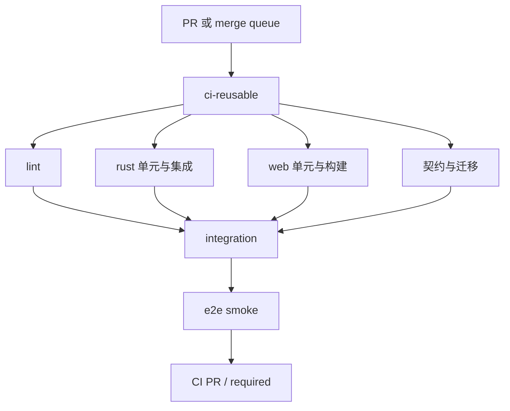
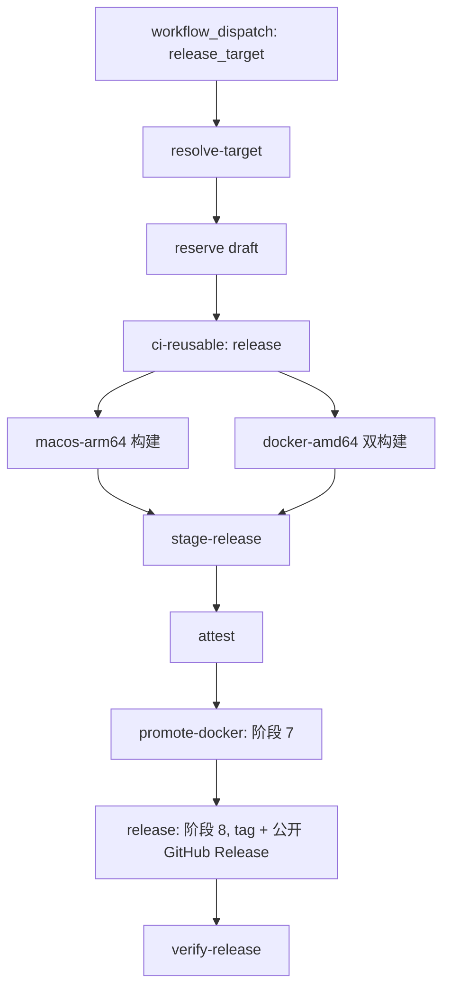

# Mien CI 与发布流水线

本文固定 GitHub Actions 上的持续集成、手动发布触发、macOS AdHoc 打包、制品和门禁。CI 只使用 GitHub-hosted runner；macOS 发布不使用 Developer ID 证书，也不使用 Apple 公证账号。版本解析、reservation、identity 和 recovery 见 [`RELEASE-POLICY.md`](RELEASE-POLICY.md)。`.github/workflows/` 的实际 YAML 在实现阶段按本文件落地；在 workflow、分支保护与发布环境配置完成前，不宣称门禁已经生效。

## 1. 固定决策

- CI 与 release 全部由 GitHub Actions 执行，不使用自托管 runner。
- PR 只使用只读权限和测试 fixture，不接触 release secrets。
- macOS 使用 AdHoc 签名（`codesign --sign -`），不公证，不做 `stapler`。AdHoc 只提供包完整性信号，不证明发布者身份。
- macOS 分发的信任链是 GitHub Release、SHA-256SUMS、GitHub artifact attestation 和 Tauri 更新签名，不是 Apple Gatekeeper。artifact attestation 是必选发布门禁，不存在按仓库计划跳过 attestation 的分支；已记录的 environment 决策也不能削弱这一要求。
- 发布由维护者手动触发 `release.yml`，输入单个 `release_target`；tag 只在 Release 阶段创建或验证，不作为触发入口。
- release workflow 使用受保护的 `release` environment，发布前需要人工批准；`promote-docker` 与 `release` 都绑定该 environment。
- Docker 固定构建 `linux/amd64`；macOS 构建 Apple Silicon `aarch64-apple-darwin`。Docker 镜像必须在同一 source 上独立构建两次并比对 digest，digest 不一致即判定失败；该比对是 ACC-010 可复现构建的证据，不能用文档声明替代。
- 项目自身许可证为 Apache-2.0；仓库根目录提供 `LICENSE`，`README` 链接该文件，发布资产包含同一文本。
- macOS 应用、嵌套 Chromium 内核及其全部 helper 的 hardened runtime 只授予 Chromium JIT 必需的 entitlements；Xray/frameworks 不带 JIT 权限。entitlements 文件是发布资产并写入 release identity。
- 第三方 Actions 固定到完整 commit SHA；依赖升级由 Dependabot 或人工 PR 完成。

## 2. Workflow 拓扑

| 文件 | 触发 | 并发 | 作用 |
| --- | --- | --- | --- |
| `.github/workflows/ci-reusable.yml` | `workflow_call` | 由调用方决定 | 共享 lint、Rust、Web、契约、集成和 e2e smoke |
| `.github/workflows/ci-pr.yml` | `pull_request` 的 `opened`、`synchronize`、`reopened`、`ready_for_review`；`merge_group` | `ci-pr-${{ github.event.pull_request.number || github.ref }}`，取消过期 candidate | PR candidate gate；`CI PR / required` 是唯一 required check |
| `.github/workflows/ci-main.yml` | `push` 到 `main` | `ci-main`，不取消在途 run | mainline 完整验证、完整 e2e 与打包 smoke |
| `.github/workflows/security.yml` | 每周 `schedule` 与 `workflow_dispatch` | `security`，不取消在途 run | 依赖、容器和已知漏洞复查 |
| `.github/workflows/release.yml` | `workflow_dispatch`，输入 `release_target` | `release`，不取消 | target 解析、reservation、全量验证、macOS/Docker 构建（Docker 双构建比对）、attestation、镜像提升、tag 与 GitHub Release、发布后验证 |

`ci-pr.yml` 不监听 `pull_request.edited`；只有代码或 review-ready 状态变化才重新评估 required gate。`ci-main.yml` 与 `release.yml` 使用独立并发 namespace，不能被 PR 的取消策略误伤。

## 3. PR 流水线

| Job | 主要命令 | 说明 |
| --- | --- | --- |
| `lint` | `cargo fmt --check`、`cargo clippy --all-targets -- -D warnings`、`cargo deny check`、`bun run license:check`、`bunx biome check .`、`bunx tsc --noEmit`、`actionlint` | Rust、前端依赖与静态检查；前端许可扫描失败阻断；不使用 `continue-on-error` |
| `rust` | `cargo nextest run --workspace` | 单元和库级集成；失败上传 nextest JUnit 报告 |
| `web` | `bun install --frozen-lockfile`、`bun run typecheck`、`bun run test`、`bun run build` | 前端类型、测试和静态资源构建 |
| `contracts` | JSON Schema 编译与 fixture 校验、OpenAPI 生成差异与 lint、内部 `$ref` 与相对链接/锚点解析、ErrorCode 目录/OpenAPI/events schema 与逐码 HTTP/retryable 映射双向比对、事件 schema 校验、SQLite DDL/迁移测试、`spec_contract_check`、seccomp 与 AppArmor 配置结构/SHA-256 校验与宿主路径加载测试、导入导出 fixture | 对应 `docs/contracts/`、`docs/ERROR-CODES.md`、`docs/specs/`、`docs/DATABASE-SCHEMA.md` 与 `deploy/docker/seccomp/`；seccomp 文件必须与 `PROVENANCE.json` 摘要一致；生成差异、未知错误码、映射漂移、断链或任一校验失败均阻断 |
| `integration` | 服务端启动、SQLite、档案生命周期、API 鉴权、代理配置与 Xray fixture | 使用真实进程和临时数据目录；不连接外部网络 |
| `e2e smoke` | Docker `linux/amd64` + Xvfb + Playwright | PR 只跑一条代表性有头启动/停止链路；完整矩阵留在 main 与 release |
| `required` | 聚合 `needs` 结果 | `if: always()`；任何上游 `failure`、`cancelled` 或意外 `skipped` 都判失败 |

PR 初始阶段不按路径过滤。等基线稳定后可以引入 classifier 减少无关 workload，但 required 聚合 job 必须始终存在并覆盖实际改动域；不能用 paths filter 让 required check 缺席。

`ci-main.yml` 复用同一套验证，但增加完整 e2e、容器矩阵、容量 smoke 和 macOS 打包 smoke。main 失败不回滚已合并代码，但阻断后续 release。

## 4. 发布流水线

发布由维护者手动触发，输入单个 `release_target`。工作流自己解析 canonical version、建立 draft reservation、验证 source 和 `CI Main / verify`，再构建和发布；不接受 tag push、PR label 或 main push 作为自动 trigger。完整 policy 见 [`RELEASE-POLICY.md`](RELEASE-POLICY.md)。

阶段顺序是固定的：`stage-release` 之后先 `attest`，再是阶段 7 `promote-docker`，阶段 8 `release`（tag 与公开 Release），最后 `verify-release`。`stage-release`、`promote-docker` 和 `release` 都绑定 `release` environment；镜像先于公开 Release 完成提升，公开 Release 只引用已经可拉取的 `vX.Y.Z` digest。

| Job | 内容 | 失败处理 |
| --- | --- | --- |
| `resolve-target` | 读取 `release_target` 和 trusted baseline（所有 `vX.Y.Z` tag 与 GitHub Release 的 SemVer 最大值，包含 prerelease 与已失效版本），解析 canonical version；先读取已有 reservation/identity，再执行 collision 检查；校验 `main` source、`CI Main / verify` | 不构建，不创建公开 release；完全匹配的同一 identity 允许 recovery；其他任何已有 tag/release 大于或等于 target 时 fail closed |
| `reserve` | 创建或复用 draft GitHub Release，使用非 `v*` 的 reservation 标识作为 `tag_name`，写入 policy、target、version、source SHA 和 run ID；后续 job 从 reservation 读取 `source_sha` 并 checkout 该 SHA，不使用 main HEAD | 不构建，不创建 `vX.Y.Z`；同 version 不同 source 直接冲突 |
| `test` | 在 reservation 的 `source_sha` 上调用 `ci-reusable.yml`，`profile=release`，运行全量测试与 e2e | 不构建发布物 |
| `macos-arm64` | 在 `release` environment 中于 `source_sha` 上构建 Tauri 应用，下载并校验内核/Xray；应用、Chromium 内核与全部 helper 使用 JIT entitlements，Xray/frameworks 不带；生成 DMG、SBOM、`LICENSE`/`NOTICE`/`LICENSES/`、entitlements 与更新清单，记录 DMG SHA-256 | identity 已记录 DMG digest 时跳过构建并复用已上传资产；重新构建使先前手动测试证据作废 |
| `docker-amd64` | 在 `source_sha` 上用 `buildx` 从同一 source 独立构建两次 `linux/amd64` 并比对 digest；不相等即失败。相等后以 `staging-<run_id>` 临时 tag 推送并记录 digest；Trivy、SBOM、容器许可扫描与 cosign keyless 签名 | 不进入 stage-release；许可扫描失败或 identity 已记录 digest 不一致时拒绝 |
| `stage-release` | 在 `release` environment 中汇总产物到 draft，包含宿主侧 seccomp 与 AppArmor 发布物与 `LICENSE`/`NOTICE`/`LICENSES/`，校验 SHA-256/digest，写入 `release-identity.json` | 本次构建 digest 与 identity 已记录 digest 不一致时拒绝；draft 保持未公开，不创建 `v*` tag |
| `attest` | 对 DMG、内核与 Xray-core 二进制、容器 digest、SBOM、许可包、seccomp 文件和 AppArmor profile 生成 GitHub artifact attestation；无跳过分支 | attestation 失败或缺失则不进入 promote-docker，不公开 release |
| `promote-docker`（阶段 7） | 把已验证 digest 提升为 `ghcr.io/<owner>/mien-server:vX.Y.Z` 并记录最终 digest；绑定 `release` environment | 不公开 release |
| `release`（阶段 8） | 校验 draft identity 和当前 DMG 的手动测试通过记录（绑定 DMG SHA-256）后创建或验证 tag，公开 GitHub Release；绑定 `release` environment | 手动测试记录缺失、未通过或绑定旧 DMG 时拒绝公开；保留 draft 供同 identity recovery |
| `verify-release` | 下载公开资产，校验 checksums、SBOM、`LICENSE`/`NOTICE`/`LICENSES/`、seccomp/AppArmor 发布物、AdHoc 签名、entitlements、更新清单和 identity | 标记 release 无效；不得静默忽略 |

tag 在 `release` job 才创建或验证，workflow 不接受 tag push 作为入口。失败后使用相同 `release_target` 和相同 `source_sha` 重跑：先读取已有 reservation 和 identity，checkout reservation 的 `source_sha`；identity 已记录某产物 digest 时对应构建 job 跳过，`stage-release` 遇到 digest 不一致即拒绝，不重新分配版本，不创建 successor。release 资产保持不可变，回滚使用上一版本 release，不覆盖已发布文件。

Deploy 不在本仓库自动执行；后续部署必须消费 `release-identity.json` 中的 digest，不按分支或 `latest` 重新构建。

## 5. macOS AdHoc 打包

macOS job 的顺序固定为：

1. 下载 fingerprint-chromium 148 DMG 和 Xray-core v26.11.9 ARM64；校验 SHA-256，记录最终二进制的 SHA-256。
2. 构建 `aarch64-apple-darwin` 应用，把内核和 Xray 放入应用资源目录。
3. 先签嵌套二进制，再签应用；使用 `codesign --force --sign - --timestamp=none --options runtime`，不使用 `--deep` 代替逐个签名。应用、Chromium 内核与全部 renderer/GPU/utility helper 使用 JIT entitlements；Xray 与 frameworks 使用 AdHoc 签名但不带 JIT 权限。
4. 签名应用、Chromium 内核与每个 helper 时传入仓库内 `mien-desktop/entitlements.plist`，只包含 Chromium V8 JIT 必需的两项：`com.apple.security.cs.allow-jit` 和 `com.apple.security.cs.allow-unsigned-executable-memory`。不授予调试、网络、文件访问或其他放宽权限；hardened runtime 下缺这两项会导致页面加载或 renderer 失败。
5. 运行 `codesign --verify --deep --strict --verbose=2`，并用 `codesign -dv --verbose=4` 断言 `Signature=adhoc`；用 `codesign -d --entitlements :-` 逐个断言应用、Chromium 内核与全部 helper 只包含上述两项，Xray 与 frameworks 不含 JIT 权限；在干净机器上加载真实页面。
6. 生成 DMG、`SHA256SUMS`、SBOM、`LICENSE`/`NOTICE`/`LICENSES/`、`entitlements.plist` 和 Tauri 更新清单；更新清单使用独立 minisign 密钥签名。
7. 在 `release` job 之前，由维护者在干净的 macOS 13+ 机器下载同一 run 的 DMG 和 `SHA256SUMS`（Actions artifact），先校验 SHA-256，再按发布说明手动放行，测试首次启动和升级；结果写入 draft 正文，未通过不得公开。
8. 手动测试证据绑定具体的 DMG SHA-256。任何一次重新构建 macOS 产物（包括同 identity 重跑中 `macos-arm64` 重新执行）都使已有手动测试证据作废，必须对新 DMG 重做并重写 draft 正文；`release` job 必须拒绝缺失、未通过或绑定旧 DMG 的记录，不得沿用旧结果。

`spctl --assess` 在 AdHoc 应用上预期失败，不作为 release gate 的成功条件；CI 记录这个预期结果。禁止在应用、安装器或发布脚本中自动移除 `com.apple.quarantine`，也禁止建议用户关闭系统级 Gatekeeper。

发布说明必须明确：

- 应用没有 Apple Developer ID 签名，也没有公证。
- 首次启动会被 Gatekeeper 阻止。
- 用户应先核对发布的 SHA-256 或 artifact attestation，再通过“系统设置 → 隐私与安全性 → 仍要打开”或用 `xattr -dr com.apple.quarantine /Applications/Mien.app` 手动放行。
- AdHoc 签名不能证明发布者身份；GitHub Release 账户和制品证明才是分发信任边界。

Tauri 自动更新使用独立的更新签名密钥，和 Apple 签名无关；客户端必须拒绝未签名或降级的更新包。更新密钥只存在于 release environment，不进入 PR 或普通 main job。

## 6. 缓存、制品与保留

| 对象 | 策略 |
| --- | --- |
| Rust 编译缓存 | `Swatinem/rust-cache`，按 `Cargo.lock` 和 runner 建立 key；不上传完整 `target/` |
| Bun 依赖缓存 | 按 `bun.lock` 建立 key；安装仍使用 `--frozen-lockfile` |
| 内核缓存 | 按发行资产 SHA-256 建立 key；恢复后必须重新校验，不信任缓存内容 |
| Playwright 浏览器 | 按锁文件和 Playwright 版本建立 key |
| PR 诊断 | nextest JUnit、失败 e2e 的 trace/screenshot/video，保留 7 至 14 天 |
| Release 资产 | DMG、Docker digest、SBOM、`LICENSE`、`NOTICE`、`LICENSES/`、`mien-seccomp-chromium-<version>.json`、`SHA256SUMS`、`release-identity.json`、`entitlements.plist`、更新清单、attestation；随 GitHub Release 长期保留，Actions artifact 保留 90 天 |
| 可复现构建证据 | Docker 双构建的两份 digest 与比对日志、两次构建的输入（`source_sha`、`Cargo.lock`/`bun.lock`、基础镜像 digest）；随 release identity 关联保留 |

成功 run 不长期上传整个 workspace、`node_modules`、浏览器安装目录或没有消费者的文件。release job 只上传可验证、可追溯的发布资产。

## 7. 权限与 Secrets

PR workflow 默认 `permissions: contents: read`；release workflow 按 job 最小授权：

| Job | 权限 |
| --- | --- |
| `resolve-target` | `contents: write`、`checks: read`、`pull-requests: read`、`actions: read`；draft reservation 只有 `contents: write` 才能被读取，另需读取 baseline tag/release、`CI Main / verify` check run 与 merged PR |
| `test` | `contents: read` |
| `reserve` | `contents: write` |
| `macos-arm64` | `contents: write`（同 identity 重跑时需读取 session 之外由 `resolve-target` 记录的 draft identity 与已上传资产，并复用 digest）；使用 `release` environment 读取更新签名密钥 |
| `docker-amd64` | `contents: read`、`packages: write`、`id-token: write` |
| `stage-release` | `contents: write`、`packages: read`（读取 GHCR digest）；绑定 `release` environment |
| `attest` | `contents: read`、`packages: write`、`attestations: write`、`id-token: write` |
| `release` | `contents: write`；绑定 `release` environment |
| `promote-docker` | `contents: write`、`packages: write`、`id-token: write`；需要读取 draft release 中记录的已验证 digest 并写回 promotion 结果；绑定 `release` environment |
| `verify-release` | `contents: write`、`issues: write`、`packages: read`（读取 GHCR digest） |

`release` environment 绑定到 `macos-arm64`、`stage-release`、`promote-docker` 与 `release` 四个 job，因此每个 job 首次进入时都会请求人工批准；这是预期行为，不是重复审批缺陷，单独 re-run 任一发布阶段也不能绕过批准。

`attest` 没有计划探测分支，也没有“仓库不支持时跳过”的路径：attestation 生成或验证失败时 workflow 停在 `attest`，不进入 `promote-docker`，也不公开 release。已记录的 environment 决策不能把它降级为可选。

`verify-release` 失败时把 release 标记为 `prerelease` 并在正文追加 `RELEASE_INVALID`，同时创建维护者 issue；不得删除资产或静默成功。

release environment 仅保存：

- `TAURI_SIGNING_PRIVATE_KEY`
- `TAURI_SIGNING_PRIVATE_KEY_PASSWORD`

不保存 `APPLE_CERTIFICATE`、`APPLE_CERTIFICATE_PASSWORD`、`APPLE_ID`、`APPLE_TEAM_ID` 或 `APPLE_APP_SPECIFIC_PASSWORD`，因为本项目不执行 Developer ID 签名和公证。Docker 的 cosign keyless 使用 GitHub OIDC，不需要长期签名私钥。

fork PR 不获得任何 release secret；不使用 `pull_request_target` 执行不可信 PR 内容。PR 标题、分支名和 issue 文本不得直接插入 shell 命令，必须经环境变量或参数数组传递。

## 8. 质量门禁合同

`main` 分支应设置为 PR-only，并至少要求：

- required check：`CI PR / required`。
- 至少一名 reviewer 批准；新提交使旧批准失效。
- 分支必须与 `main` 同步。
- 管理员同样受保护规则约束，不直接 push。
- 启用 merge queue 时，`merge_group` 运行同一套 required gate。

`ci-pr.yml` 的 workflow name 固定为 `CI PR`，聚合 job 名固定为 `required`；因此 check 名为 `CI PR / required`。`ci-main.yml` 的 workflow name 固定为 `CI Main`，主验证 job 名为 `verify`。`CI PR / required` 是一个聚合 job，只有所有适用上游 job 成功才成功。workflow 或 job 名称在 YAML 落地后必须与 GitHub 分支保护中的 check 名逐字核对；在未核对前，文档只记录设计，不宣称已经 enforce。

`CI Main / verify` 用于 mainline 健康检查，不替代 PR required check。release workflow 不是 PR 门禁，但它的 `resolve-target` 与 `test` 必须在发布物构建前成功。

tag 保护使用仓库 ruleset，目标模式 `v*`，启用 `Restrict updates`、`Restrict deletions` 与 `Restrict creations`。bypass 仅允许 release GitHub App（由受保护的 `release` environment 签发），不允许任何人类角色或日常 `GITHUB_TOKEN` 绕过；`release` job 通过该 App 创建 `vX.Y.Z`。已有 tag 只能读取和验证 peeled commit，任意有 tag 写权限的身份不能抬高 trusted baseline。

发布门禁还包括：仓库根 `LICENSE`、`NOTICE`、`LICENSES/` 存在且 `README` 已链接，第三方再分发义务检查完成；Docker 两次构建 digest 相等；artifact attestation 已生成并通过验证；GATE-001 的 `accepted` 结果必须携带完整 waiver 记录，P0 与阻断类 P1 不得使用 `accepted`。任一项缺失即阻断公开 release。

## 9. 失败、重跑与回滚

- PR gate 失败时修复代码或测试；不使用 `continue-on-error`、降低断言、删除 required check 或扩大 waiver 来变绿。
- 只有已确认的瞬态网络故障可以重试；flaky 测试、锁竞争和超时按缺陷处理。
- release 在 `release` job 前失败时，draft reservation 保留，不创建公开 release；用同一 target、同一 source SHA 重跑，checkout reservation 的 `source_sha`，复用已绑定 canonical version，不重新计算 successor。
- 重跑时，identity 已记录 digest 的产物不再构建：`macos-arm64`、`docker-amd64` 直接复用已上传资产和 digest；`stage-release` 发现本次构建 digest 与已记录 digest 不一致时拒绝写入，不为迁就新构建而覆盖 identity。
- 重新构建 macOS 产物使手动测试证据作废；必须对新 DMG 重做开箱/升级测试并重写 draft 正文后才能公开。
- Docker digest 两次构建不相等时，不推送 staging tag、不进入 `stage-release`；按构建不可复现缺陷处理，不得以“只差一层元数据”为由接受。
- `stage-release` 只写 draft；全部资产、identity 和 attestation 验证通过后，阶段 7 `promote-docker` 先提升镜像，阶段 8 `release` 再由 release App 创建或验证 `vX.Y.Z` tag 并公开。公开后 `verify-release` 失败时，立即标记 release 无效并通知维护者。
- 回滚只使用上一版本 release；需要修正构建时必须选择新的 `release_target`，产生新的 version 和 identity。不覆盖已发布资产，不删除用户数据，不降低数据库迁移兼容性。

## 10. 实施顺序

1. M0：建立 `ci-reusable.yml`、`ci-pr.yml` 和 `ci-main.yml` 的最小骨架，先跑 fmt、lint、单元测试和契约校验；第一个纵向切片合并前把 `CI PR / required` 设为真实 required check，不允许先跳过契约门禁。
2. M1：加入 SQLite、API、生命周期与 Xray fixture 集成；保持 `CI PR / required` 为真实 required check，不因新增 job 而缺席。
3. M2：加入 Docker e2e smoke、内核下载校验和代理矩阵 fixture。
4. M3：加入 macOS 打包 smoke、AdHoc 签名与 entitlements 验证、SBOM 与 Trivy。
5. M4：启用 `release` environment、draft reservation、手动 `release_target` workflow、tag 保护（`Restrict updates` + `Restrict deletions` + `Restrict creations`，仅 release App 绕过 creations）、强制 attestation、更新清单和发布后验证；加入 Docker 双构建 digest 比对与 Apache-2.0 `LICENSE`/`NOTICE`/`LICENSES/` 门禁。

## 11. 参考

- [`RELEASE.md`](RELEASE.md)
- [`RELEASE-POLICY.md`](RELEASE-POLICY.md)
- [`TEST-PLAN.md`](TEST-PLAN.md)
- [`SECURITY.md`](SECURITY.md)
- [`TECH-STACK.md`](TECH-STACK.md)
- [`adr/0010-adhoc-macos-distribution.md`](adr/0010-adhoc-macos-distribution.md)
- [`adr/0011-manual-release-identity.md`](adr/0011-manual-release-identity.md)
- [`contracts/`](contracts/)
