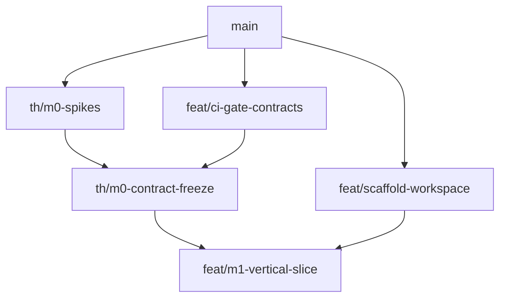

# Mien 开工编排计划：M0 可行性 → 契约冻结 → M1 纵向切片

本文是 [`DELIVERY-PLAN.md`](DELIVERY-PLAN.md) 的执行编排：把已锁定文档落成 Orca Run、Task DAG、worktree 与 agent 分工、每张 Task 的证据门槛和人工停靠点。它不改变任何契约；冲突时以 `DELIVERY-PLAN.md`、`docs/specs/` 与 `docs/contracts/` 为准。

## 1. 结论先行

- 仓库目前只有文档，没有任何代码、`Cargo.toml`、`package.json`、`.github/`；开工第一步必须是脚手架，否则每个并行切片都会各自造骨架。
- 首个合并到 `main` 的切片前，`CI PR / required` 与 `contracts` job 必须是真实 required check（交付计划 2.4）；M0 spike 先以分支 + `docs/spikes/` 证据形态存在，CI 门禁落地后耗尽后收口。
- M1 依赖 M0 的 Xray 动态 API、内核能力清单与 Docker 沙箱/显示结论；只有脚手架与 CI 骨架可真正并行。
- 所有写入型 Task 使用**独立 child worktree**，由协调者（本会话）串行合并；`docs/spikes/`、`Cargo.lock`、`bun.lock`、`docs/contracts/` 为高冲突区，必须单一 owner。

## 2. 分支与 worktree 拓扑

- 每个 Task 从父分支开 `new-child` worktree，完成后协调者评审、合入父分支并删除 worktree。
- `th/m0-spikes` 与 `feat/m1-vertical-slice` 最终以 PR 合入 `main`；`feat/ci-gate-contracts` 与 `feat/scaffold-workspace` 可各自独立 PR，但 `contracts` job 落地前不得合并任何业务实现。
- Task 7（指针测试）单独一个 child，只改 `docs/TEST-FIXTURES.md`，不与其他 Task 共写。

## 3. 顺序与并行波次

| 波次 | Task | 依赖 | 并行度 | 说明 |
| --- | --- | --- | --- | --- |
| A | T1 CI 门禁骨架 | 无 | 2 | 与 T2 同批启动 |
| A | T2 workspace 脚手架 | 无 | | 与 T1 同批启动 |
| B | T3 Xray 共享引擎 spike | T2 | 2 | 写 `docs/spikes/xray/` |
| B | T4 内核能力清单 spike | T2 | | 写 `docs/spikes/kernel/` |
| B | T5 Docker 显示/沙箱 spike | T2 | | 写 `docs/spikes/docker/`，需 linux/amd64，走 Agent VM |
| C | T6 许可评审 | T3、T4、T5 | 1 | 闭合 THIRD-PARTY，产出 NOTICE/LICENSES 方案 |
| C | T7 测试 fixture 指针 | T2 | | 独立 child，只改 TEST-FIXTURES |
| D | T8 契约冻结与 CI 校验接入 | T1、T3、T4 | 1 | 单一 owner 覆盖 `docs/contracts/`、OPENAPI/DDL 校验 |
| E | T9 M1 纵向切片 | T2、T8 | 5 条并行链 | 见 §4.2，各链独立 worktree |
| E | T10 macOS AdHoc/更新签名准备 | T3 | | 与 T9 并行，M3 前必须具备 |

波次 A 同时起 2 个；波次 B 同时起 3 个（上限 4）；T9 内 5 条链路按 4 个一批启动，剩余一条在首个返回后启动。

## 4. Task 规格要点

每张 Task 下发时为完整 spec：目标、改动文件域、禁改域、验收命令与非零退出含义。以下是摘要。

### 4.1 M0

| ID | 目标 | 交付证据 | 验收 |
| --- | --- | --- | --- |
| T1 | 按 `CI.md` §2–3 建 `ci-reusable.yml`、`ci-pr.yml`、`ci-main.yml`；`contracts` job 跑 schema 编译、DDL 执行、`$ref`/链接解析、`spec_contract_check`、seccomp/AppArmor 摘要校验 | workflow 文件、`actionlint` 通过、本地 `cargo xtask contracts` | PR 中 `CI PR / required` 为唯一 required check；红用例能阻断 |
| T2 | Rust workspace（edition 2024、MSRV 1.85）、`xtask`、`mien-core`/`mien-desktop`/Web 壳、SQLite 迁移骨架、Biome/clippy/deny 基线 | 可 `cargo build`、`bun run build`、空迁移可执行 | `cargo xtask check` 全绿；不实现业务 |
| T3 | `XRAY-MAPPING.md` 全项 spike：API 入站、共享出站、引用计数、强杀重建、TUIC 拒绝、非回环不可达 | `docs/spikes/xray/` 记录、可重跑脚本 | ENGINE-001/002/003/005/009 有实测结论 |
| T4 | 逐项验证 148 开关、有头/无头/伪有头差异、UA 补丁作用域 | `docs/spikes/kernel/` 能力清单差异表 | KERNEL-001..007 有实测；无效果开关不入清单 |
| T5 | `linux/amd64`：非 root、只读根、Xvfb+openbox、沙箱判定、Hysteria2 UDP、noVNC 令牌 | `docs/spikes/docker/`、seccomp/AppArmor 草稿 | KERNEL-008、PROXY-027..029 结论明确 |
| T6 | MPL-2.0 与镜像 GPL/LGPL 义务评审，NOTICE/LICENSES/SBOM 生成方案 | `THIRD-PARTY.md` 闭合、`NOTICE` 方案 | 无未决许可项；ENGINE-007/SEC-007 |
| T7 | TEST-FIXTURES 目录与所有权写实 | `TEST-FIXTURES.md` 修订 | 目录路径与 §5 fixture 表一一对应 |
| T8 | 冻结 OpenAPI/events/错误码/DDL/清单/UI surface；接入 CI 生成差异与双向比对 | `docs/contracts/*`、`docs/ERROR-CODES.md`、`DATABASE-SCHEMA.md` | 契约 CI 全绿；任一漂移即红 |
| T10 | Tauri 更新 minisign 密钥、`release` environment、draft reservation 说明 | `RELEASE-POLICY.md` 增补、密钥生成记录 | 密钥可签名并可验证 |

### 4.2 M1 切片链路（T9）

| 链 | owner 范围 | 对应验收 |
| --- | --- | --- |
| A SQLite + 档案模型 | 迁移、事务、数据目录隔离、路径安全 | PROFILE spec、EXPORT-006 |
| B 指纹校验 + argv 构建器 | `validate_spec`、`build_launch_argv`、golden fixture | FP-001..013 |
| C Xray bootstrap + 引用计数 | 共享引擎、入站/路由、失败关闭 | ENGINE-003/005/009、PROXY-003/005/009 |
| D macOS 有头启动/停止/日志 | 状态机、进程组、事件 | RT-001..026 子集 |
| E Profiles 首屏与表单 | 路由、三档运行模式、降级提示 | UI-001..009 |

- 链内按 A→B→C→D→E 的合并顺序回到 `feat/m1-vertical-slice`；E 依赖 A/B 的契约类型，允许并写但在 A/B 合入前不合并。
- 任一切片必须能在本机跑通 `cargo xtask check` 与对应测试；失败路径返回稳定错误码，不得出现直连回退。

## 5. 人工停靠点（必须主人放行）

1. 批准本计划与 §4 每张 Task 的 spec。
2. 波次 B 结束、进入冻结前，审阅三份 spike 结论与「是否继续 M1」。
3. `docs/contracts/` 冻结版本审阅（T8 输出）。
4. 波次 E 合并到 `feat/m1-vertical-slice` 后，macOS 手工探针验收。
5. 首次 push / PR 创建。

## 6. 协调者规则

- 协调者只做：发 spec、读证据、串行合并、处理升级问题、跑最终检查；不自己开工。
- worker 回报缺证据或验收不达标时，发 `send` 修，不整张重跑；只有进程确认退出（`exited`）才重试。
- 合并前必须确认：契约未漂移、`docs/spikes/` 证据在、CI 全绿、无孤儿进程残留。
- 阻塞项（例如无受控 Tier A 节点）当日上报，不静默降级或跳过验收。
