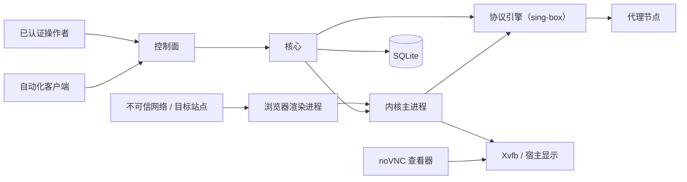

# Snailfish 安全与威胁模型

## 1. 范围与安全目标

本文覆盖 macOS 桌面应用、Docker 服务端、控制面、SQLite 数据、档案目录、代理网关与协议引擎、指纹内核供应与容器运行环境。安全目标是：

- 未认证用户不能读取或修改档案、运行时、代理和 Token。
- 代理凭据、API Token、Cookie 和主密钥不以明文出现在数据库、日志、事件、错误或进程参数中。
- 浏览器渲染不可信网页时，容器与内核沙箱提供可验证的隔离边界；无沙箱运行必须显式授权并记录。
- 控制面、CDP、noVNC 和协议引擎 mixed 入站默认不暴露到非必要网络。
- 内核、协议引擎与发布物可校验、可回滚、可追溯；升级不静默改变运行中档案。
- 产品不宣称匿名性或对抗取证能力，不把安全边界建立在“用户不会攻击自己”的假设上。

## 2. 资产

| 资产 | 位置 | 影响 |
| --- | --- | --- |
| 代理凭据 | SQLite 加密字段、协议引擎配置与内存 | 泄露可导致代理额度被盗或流量被滥用 |
| API Token | SQLite 哈希、客户端 | 泄露可控制档案和运行时 |
| 浏览器会话数据 | `<data-root>/profiles/<id>/chrome` | Cookie、LocalStorage、站点数据泄露 |
| 主密钥 | macOS 钥匙串、`/data/secrets/master.key` 或环境变量 | 泄露可解密代理凭据 |
| 档案与运行日志 | SQLite、日志文件 | 泄露操作历史、目标站点和错误细节 |
| 内核二进制 | 应用资源、镜像、`kernels/` | 篡改可执行任意代码 |
| 协议引擎二进制 | 应用资源、镜像、`engines/` | 篡改可执行任意代码或窃取代理凭据 |
| 控制面与 noVNC | 容器网络、反向代理 | 未授权控制浏览器 |
| 审计事件 | SQLite | 影响追责与事件调查 |

## 3. 信任边界

边界说明：

- 浏览器渲染进程按不可信代码处理，可能被恶意网页攻击。
- 控制面是网络边界，必须认证、授权、限流和防 CSRF。
- 协议引擎是凭据与协议边界，内核不得接触代理凭据。
- 内核与协议引擎二进制是供应链边界，必须校验和版本绑定。
- Xvfb、noVNC、CDP 是高权限入口，默认最小暴露。

## 4. 威胁模型

| 编号 | 威胁 | 攻击路径 | 控制 | 残余风险 |
| --- | --- | --- | --- | --- |
| T-01 | 未认证访问控制面 | 直接请求档案、启动或删除端点 | 所有非健康端点强制认证；默认只暴露必要端口；反向代理 TLS | 部署者错误公开端口仍可能暴露登录页 |
| T-02 | 会话或 Token 窃取 | XSS、日志、URL、共享终端 | HttpOnly/SameSite Cookie；Token 只存哈希；不在 URL 放长效 Token；CSP；脱敏 | 同用户恶意软件可读取浏览器会话 |
| T-03 | CSRF | 恶意站点诱导已登录浏览器发起写请求 | SameSite=Strict；Origin 校验；CSRF Token；Bearer Token 不受 Cookie 影响 | 旧浏览器或错误代理配置可能削弱 SameSite |
| T-04 | 登录暴力破解 | 自动化尝试密码 | 登录限流、递增锁定、统一错误消息、Argon2id | 分布式低频尝试仍可能持续 |
| T-05 | 代理凭据泄露 | 进程参数、引擎配置、日志、错误、数据库 | 凭据加密存储；引擎配置 0600 且启动后删除；日志脱敏；Chromium argv 不含凭据 | 内存转储和同用户调试可读取运行中凭据 |
| T-06 | 浏览器数据被盗 | 读取档案目录、备份、容器卷 | 目录 0700；卷加密建议；最小权限；备份加密 | 同用户或宿主 root 可读取 Cookie 文件 |
| T-07 | 路径穿越或恶意导入 | `../`、绝对路径、符号链接、超大文件 | 规范化路径、前缀校验、拒绝符号链接、大小限制、schema 校验 | 文件系统竞态需要实现时额外防护 |
| T-08 | Web UI XSS | 档案名称、备注、代理字段注入脚本 | 输出编码；CSP；禁止内联脚本；导入字段转义 | 第三方依赖漏洞 |
| T-09 | CDP 暴露 | 远程连接调试端口控制浏览器 | 默认关闭；只绑定回环；容器不映射；启动响应只返回回环地址 | 同用户本地进程可连接回环 CDP |
| T-10 | noVNC 暴露 | 直接访问 VNC/WebSocket | 默认关闭；一次性令牌；容器网络限制；不默认公网映射 | 令牌在有效期内被截获 |
| T-11 | 恶意网页利用内核漏洞 | canvas/WebGL 读回、渲染进程攻击 | 强制沙箱；站点隔离；固定内核并跟踪上游；不允许默认无沙箱 | 148 存在已报告越界访问（#102） |
| T-12 | 容器逃逸或权限过大 | root、额外 capability、挂载 Docker socket | 非 root；cap-drop ALL；no-new-privileges；只读根；seccomp/AppArmor；不挂载宿主目录 | 内核或运行时漏洞 |
| T-13 | 内核或引擎供应链篡改 | 替换二进制、劫持下载、静默升级 | 固定 URL；SHA-256；签名应用/镜像；版本绑定；不静默下载；能力清单 | 上游构建或签名密钥被攻破 |
| T-14 | 日志泄露 | 记录代理 URL、Token、Cookie、页面内容 | 结构化日志字段白名单；统一脱敏；日志轮转与权限 | 调试日志可能临时包含更多信息 |
| T-15 | 同用户滥用回环代理 | 本机进程连接协议引擎 mixed 端口 | 回环绑定；随机端口；短生命周期；容器网络隔离 | macOS 同用户进程仍可使用 |
| T-16 | 主密钥丢失或泄露 | 误删钥匙串、环境变量泄露 | 钥匙串或 0600 文件；Secret 管理；备份流程；轮换流程 | 丢失后敏感字段不可恢复 |
| T-17 | 无沙箱运行 | 容器默认配置无法启用沙箱 | 启动前检查；默认拒绝；`ALLOW_UNSANDBOXED=1` 显式授权并审计 | 恶意网页可直接攻击浏览器主进程 |
| T-18 | 网络泄漏 | DNS、WebRTC、IPv6、DoH 绕过代理 | 远程 DNS；`--disable-non-proxied-udp`；DoH 禁用；IPv6 阻止；失败关闭；canary 测试 | 代理节点自身行为不可控 |
| T-19 | 产品被滥用 | 欺诈、垃圾信息、规避平台规则 | 可接受使用政策；不提供代理/账号/验证码；限制分发；保留终止支持权利 | 无法完全阻止双用途使用 |
| T-20 | 备份或导出泄露 | 明文导出、未加密卷、共享备份 | 默认导出不含秘密；加密导出；卷加密建议；备份权限 | 用户自行复制导出文件 |
| T-21 | 恶意代理配置或分享链接 | 注入未知字段、路径、超大输入、伪造协议参数 | 类型化 schema；字段白名单；大小限制；不联网解析；不直接透传用户 JSON | 解析器漏洞或合法但恶意节点行为 |
| T-22 | 协议引擎配置泄露 | 读取临时配置、崩溃转储、进程参数 | 0600 文件；启动后删除；不写入 argv；日志脱敏；最小化配置生命周期 | 同用户或 root 可在启动窗口读取 |

## 5. 控制措施

### 5.1 身份与授权

- 服务端首次启动生成高熵管理员密码，写入受保护文件或由部署者通过环境变量提供；首次登录后要求修改。
- 会话 Cookie 使用 `HttpOnly`、`SameSite=Strict`；TLS 部署时使用 `Secure`。
- API Token 高熵随机、只存哈希、可撤销、带范围；Token 创建时只显示一次。
- v1 不实现多用户 RBAC；服务端只有一个管理员身份和范围化 Token。多用户属于后续范围。
- 所有写操作检查认证、授权、Origin 与 CSRF；Bearer Token 请求不依赖 Cookie。

### 5.2 密钥与数据

- 代理凭据、UUID、密码、私钥、Token 等敏感字段使用 AES-256-GCM；AAD 绑定记录标识和字段名，防止密文搬移。
- 桌面主密钥存入登录钥匙串；服务端使用 `/data/secrets/master.key`（0600）或 Secret 管理注入的环境变量。
- 登录密码使用 Argon2id；Token 使用带 pepper 的哈希。
- 数据目录权限 0700；日志文件 0600；容器内运行用户独占数据卷。
- 浏览器档案目录不做应用层加密；部署要求全盘或卷加密。
- 主密钥丢失时不自动清空数据；进入不可用状态，要求恢复或显式重置。

### 5.3 进程与文件

- 内核使用参数数组启动，不经过 shell；子进程环境变量最小化。
- 进程组管理；正常停止优先 SIGTERM，超时后终止进程组。
- 档案锁与并发配额；控制面重启后按 PID、启动时间和命令行对账。
- 路径规范化、前缀校验、拒绝符号链接；导入文件大小与 schema 限制。
- 内核首次启动前校验 SHA-256；校验失败拒绝启动。
- 协议引擎首次启动前校验版本与 SHA-256；配置写入 0600 文件并在启动后删除。

### 5.4 网络

- 控制面默认只监听必要接口；Docker 通过端口映射和反向代理控制暴露。
- 协议引擎 mixed 入站和 CDP 只绑定 `127.0.0.1`；容器不映射这些端口。
- noVNC 默认关闭；开启时使用一次性令牌或独立认证。
- 代理默认远程 DNS、禁用非代理 UDP、禁用 DoH 绕过；IPv6 不能代理时阻止。
- 引擎失败关闭，不回退直连；容器网络限制直连出口。

### 5.5 容器

- 运行用户非 root；根文件系统只读；`/data` 为唯一可写卷。
- `cap-drop ALL`、`no-new-privileges`、seccomp/AppArmor；不挂载 Docker socket 或宿主敏感目录。
- 启动前验证 Chromium 沙箱状态；无法确认时拒绝启动。
- 镜像固定摘要、SBOM、漏洞扫描；不使用浮动 `latest` 作为生产标签。
- 资源限制：CPU、内存、PID、打开文件数，避免单档案拖垮宿主。

### 5.6 供应链与更新

- 内核与协议引擎固定版本、固定 URL、SHA-256 清单；不静默下载或替换。
- macOS 应用、嵌套内核、sing-box 二进制和更新包使用 Developer ID 签名；发布前公证。
- Docker 镜像签名或摘要固定；构建使用锁定的依赖版本。
- 升级经过内核准入与协议矩阵；运行中档案不被替换；保留回滚版本。
- 发布物包含 BSD-3-Clause、GPL-3.0 许可声明、上游源码链接或书面要约；sing-box 名称使用限制完成法律评审。

### 5.7 协议引擎

- sing-box 作为独立进程运行，不修改二进制；配置由产品生成而不是直接透传用户 JSON。
- 每个档案一个引擎；只生成 loopback mixed 入站和代理出站，不启用 Clash API，不生成直连回退。
- 引擎配置包含凭据，权限 0600，启动成功后删除；崩溃重启时从加密数据库重新生成。
- 引擎日志按白名单采集并脱敏；禁止记录完整配置、UUID、密码、私钥、分享链接和目标 URL。
- 引擎能力清单驱动 UI 与校验；未声明协议或传输不得展示或提交。

### 5.8 日志与审计

- 日志字段白名单：时间、级别、请求标识、档案标识、运行时标识、事件、错误码、延迟、字节数。
- 禁止记录密码、Token、Cookie、授权头、完整代理 URL、UUID、私钥、分享链接、完整目标 URL、页面内容。
- 审计事件包含操作者、动作、目标、结果、请求标识和时间；不可通过普通用户操作删除。
- 日志轮转、权限限制、保留期限；导出日志前再次脱敏。

## 6. 残余风险

| 残余风险 | 严重性 | 说明 | 处理 |
| --- | --- | --- | --- |
| 148 WebGL readPixels 越界访问（#102） | 高 | 恶意页面可触发渲染进程内存错误 | 强制沙箱；禁止默认无沙箱；跟踪上游；安全兜底为补丁分支 |
| 字体与屏幕属性宿主泄漏（#105） | 中 | 跨系统画像仍可被字体和显示属性识别 | 默认主机对齐；UI 与测试报告显式标注 |
| 无头特征差异 | 中 | 无头模式只替换部分特征 | 默认有头；无头标记降低保证 |
| CDP 输入坐标可检测（#110） | 中 | 自动化事件与真实输入存在差异 | 仅作为自动化接口；不承诺反检测 |
| 同用户进程可访问协议引擎 mixed/CDP | 中 | 本机同用户恶意程序可滥用 | 回环、随机端口、短生命周期；建议独立用户与终端保护 |
| 浏览器 Cookie 未应用层加密 | 中 | 同用户或 root 可读取 | 全盘/卷加密；目录权限；最小账户 |
| 代理节点行为不可控 | 中 | 节点可能记录、注入或泄漏 | 用户选择可信节点；不内置代理；文档说明 |
| 协议引擎漏洞或崩溃 | 高 | 引擎处理不可信网络数据和凭据 | 固定版本、校验和、能力清单、失败关闭、日志脱敏、及时更新 |
| 节点主机名 bootstrap 解析 | 低 | 本地解析会暴露节点域名 | 只解析节点主机名；支持 IP 节点；UI 与文档说明 |
| 容器内核或运行时漏洞 | 高 | 可能逃逸 | 非 root、最小能力、及时更新、镜像扫描 |
| 主密钥丢失 | 中 | 敏感字段不可恢复 | 备份流程；显式重置；不自动清空 |
| 第三方依赖漏洞 | 中 | 供应链攻击 | 锁文件、审计、SBOM、及时更新 |
| 上游停止维护或无修复 | 中 | 内核缺陷长期存在 | 版本准入、回滚、补丁分支预案 |

## 7. 部署加固

### 7.1 macOS

- 从签名发布物安装；启用 Gatekeeper；不在共享账户或公共机器上运行。
- 开启 FileVault；使用独立登录账户；限制数据目录访问。
- 主密钥仅存登录钥匙串；不要在脚本中传递主密钥。
- 保持应用、内核和协议引擎版本受控；不使用未校验的第三方二进制。
- 自动化 API 默认关闭；需要时只绑定回环并定期轮换 Token。

### 7.2 Docker

- 使用固定摘要镜像；不使用 `latest`。
- 以非 root 运行；`--read-only`；`/data` 为唯一可写卷。
- `--cap-drop ALL`；`--security-opt no-new-privileges`；按需 seccomp/AppArmor。
- 不挂载 Docker socket、宿主 home、SSH 密钥或其他敏感目录。
- 限制 CPU、内存、PID 和文件描述符；设置健康检查。
- 反向代理终止 TLS；只暴露控制面端口；noVNC 不默认发布。
- 数据卷使用加密存储；主密钥通过 Secret 管理或 0600 文件提供。
- 限制容器出站网络，仅允许协议引擎到代理节点的必要连接；Hysteria2/TUIC 需要允许 UDP 出站。
- 启用镜像扫描与日志收集；定期轮换管理员密码和 Token。

## 8. 安全验收门禁

- 无 P0/P1 安全问题。
- 未认证、越权、CSRF、登录限流、Token 撤销测试通过。
- 数据库敏感字段为密文；日志、事件、错误无敏感值；引擎配置 0600 且启动后删除。
- 路径穿越、符号链接、恶意导入测试通过。
- 容器非 root、只读根、最小能力、无 Docker socket；沙箱状态可验证。
- 内核与协议引擎校验和验证、版本绑定、回滚测试通过。
- CDP 与 noVNC 默认不可从容器外访问；查看器令牌一次性有效。
- 代理 DNS/WebRTC/IPv6/DoH/失败关闭测试通过；Tier A 协议矩阵与分享链接导入通过。
- GPL-3.0 许可、源码要约和名称使用限制评审完成。
- 依赖与镜像扫描无未接受的高危项。

## 9. 漏洞响应

- 安全问题通过私有渠道报告，不在公开 issue 中披露利用细节。
- 维护者确认影响范围、受影响版本和缓解措施；必要时暂停分发或撤回镜像。
- 修复后发布安全公告，说明受影响版本、修复版本、缓解步骤和是否涉及内核。
- 凭据可能泄露时，指导用户轮换代理凭据、API Token 和管理员密码。
- 内核漏洞由上游修复时，按内核准入流程评估；无法及时修复时采用沙箱、功能降级或补丁分支。
- 协议引擎漏洞由上游修复时，按引擎准入流程评估；无法及时修复时限制受影响协议或回退到受支持版本。

## 10. 隐私与合规

- 默认不发送遥测；更新检查可关闭；不收集浏览历史、目标站点或代理凭据。
- 日志与审计仅保留运维所需字段，按配置期限删除。
- 用户删除档案时清理对应数据目录；备份与导出由用户自行管理。
- 产品不提供匿名性、抗取证或绕过平台规则的保证。
- 可接受使用政策禁止欺诈、身份盗用、未经授权访问、垃圾信息和其他违法用途；用户对代理、账号和使用行为负责。
- sing-box 作为独立 GPL-3.0 程序分发；发布物保留许可证、源码链接或书面要约，不修改二进制，不使用其名称暗示关联。

## 11. 参考

- [`PRD.md`](PRD.md)
- [`ARCHITECTURE.md`](ARCHITECTURE.md)
- [`TEST-PLAN.md`](TEST-PLAN.md)
- [`specs/control-api/SPEC.md`](specs/control-api/SPEC.md)
- [`specs/proxy-gateway/SPEC.md`](specs/proxy-gateway/SPEC.md)
- [`adr/0002-pin-kernel-148.md`](adr/0002-pin-kernel-148.md)
- [`adr/0007-protocol-engine-forward-proxy.md`](adr/0007-protocol-engine-forward-proxy.md)
