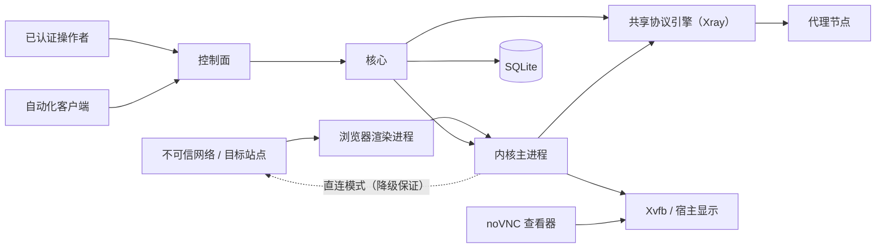

# Mien 安全与威胁模型

## 1. 范围与安全目标

本文覆盖 macOS 桌面应用、Docker 服务端、Tauri IPC、控制面、SQLite 数据、档案目录、代理网关与协议引擎、指纹内核供应与容器运行环境。安全目标是：

- 未认证用户不能读取或修改档案、运行时、代理和 Token。
- 代理凭据、API Token、Cookie 和主密钥不以明文出现在数据库、日志、事件、错误或进程参数中。
- 浏览器渲染不可信网页时，容器强制加载版本化 seccomp 配置并启用 Chromium 命名空间沙箱，形成可验证的隔离边界；无沙箱运行必须显式授权、限制爆炸半径并记录。
- 直连模式（direct）是显式降级配置：桌面端允许但必须标记降低保证，服务端仅在显式设置 `MIEN_ALLOW_DIRECT_EGRESS=1` 并写入审计后允许。
- 控制面、CDP、noVNC、运行档案 HTTP 入站和 Xray 管理 API 默认不暴露到非必要网络。
- 桌面管理 UI 只通过 Tauri IPC 调用核心，不开放本地 HTTP 管理端口；自动化 HTTP API 独立、默认关闭、仅回环并需要 Token。
- 内核、协议引擎与发布物可校验、可回滚、可追溯；升级不静默改变运行中档案。
- 产品不宣称匿名性或对抗取证能力，不把安全边界建立在“用户不会攻击自己”的假设上。

## 2. 资产

| 资产 | 位置 | 影响 |
| --- | --- | --- |
| 代理凭据 | SQLite 加密字段、协议引擎配置与内存 | 泄露可导致代理额度被盗或流量被滥用 |
| API Token | SQLite 哈希、客户端 | 泄露可控制档案和运行时 |
| 浏览器会话数据 | `<data-root>/profiles/<id>/chrome` | Cookie、LocalStorage、站点数据泄露 |
| 主密钥 | macOS 钥匙串、`<data-root>/secrets/master.key`（Docker 下即 `/data/secrets/master.key`）或环境变量 | 泄露可解密代理凭据 |
| 档案与运行日志 | SQLite、日志文件 | 泄露操作历史、目标站点和错误细节 |
| 内核二进制 | 应用资源、镜像、`kernels/` | 篡改可执行任意代码 |
| 协议引擎二进制 | 应用资源、镜像、`engines/` | 篡改可执行任意代码或窃取代理凭据 |
| 控制面与 noVNC | 容器网络、反向代理 | 未授权控制浏览器 |
| 审计事件 | SQLite | 影响追责与事件调查 |
| 管理员初始凭据 | Secret 管理、`MIEN_ADMIN_PASSWORD_FILE`、内联 `MIEN_ADMIN_PASSWORD`（进程环境，`docker inspect` 与 `/proc/1/environ` 可见）或 `<data-root>/secrets/admin-bootstrap` | 泄露可接管控制面；内联环境变量仅限一次性引导，首次改密后删除应用生成的文件、清除引导标记并撤销外部环境变量/Secret |
| 容器 seccomp 配置 | 仓库 `deploy/docker/seccomp/chromium.json`、宿主侧发布物 `/etc/mien/seccomp/chromium.json`、镜像内审计副本 `/opt/mien/seccomp/chromium.json` | 被替换或缺失会关闭 Chromium 沙箱边界；Docker 只在容器创建前读取宿主侧文件 |

## 3. 信任边界



边界说明：

- 浏览器渲染进程按不可信代码处理，可能被恶意网页攻击。
- 直连模式的浏览器流量不经过协议引擎，T-18 的代理侧控制不适用；该路径必须被视为降低保证并显式标记。
- 控制面是网络边界，必须认证、授权、限流和防 CSRF。
- 共享协议引擎是凭据与协议边界，管理 API 是高权限控制面；内核不得接触代理凭据。
- 内核与协议引擎二进制是供应链边界，必须校验和版本绑定。
- Xvfb、noVNC、CDP 是高权限入口，默认最小暴露。

## 4. 威胁模型

| 编号 | 威胁 | 攻击路径 | 控制 | 残余风险 |
| --- | --- | --- | --- | --- |
| T-01 | 未认证访问控制面 | 直接请求档案、启动或删除端点 | 公开白名单与契约完全一致：仅 `/healthz`、`/readyz`、`/api/v1` 发现、`/api/v1/auth/login`、`/api/v1/openapi.json`；其余端点强制认证；默认只暴露必要端口；反向代理 TLS | 部署者错误公开端口仍可能暴露登录页 |
| T-02 | 会话或 Token 窃取 | XSS、日志、URL、共享终端 | HttpOnly/SameSite Cookie；Token 只存展示前缀与 HMAC 哈希；不在 URL 放长效 Token；CSP；脱敏 | 同用户恶意软件可读取浏览器会话 |
| T-03 | CSRF | 恶意站点诱导已登录浏览器发起写请求 | SameSite=Strict；Origin 校验；CSRF Token；Bearer Token 不受 Cookie 影响 | 旧浏览器或错误代理配置可能削弱 SameSite |
| T-04 | 登录暴力破解 | 自动化尝试密码 | 登录限流、递增锁定、统一错误消息、Argon2id | 分布式低频尝试仍可能持续 |
| T-05 | 代理凭据泄露 | 进程参数、引擎 API、日志、错误、数据库 | 凭据加密存储；只经回环 API 传递；日志脱敏；Chromium argv 不含凭据 | 内存转储和同用户调试可读取运行中凭据 |
| T-06 | 浏览器数据被盗 | 读取档案目录、备份、容器卷 | 目录 0700；卷加密建议；最小权限；备份加密 | 同用户或宿主 root 可读取 Cookie 文件 |
| T-07 | 路径穿越或恶意导入 | `../`、绝对路径、符号链接、超大文件 | 规范化路径、前缀校验、拒绝符号链接、大小限制、schema 校验 | 文件系统竞态需要实现时额外防护 |
| T-08 | Web UI XSS | 档案名称、备注、代理字段注入脚本 | 输出编码；CSP；禁止内联脚本；导入字段转义 | 第三方依赖漏洞 |
| T-09 | CDP 暴露 | 远程连接调试端口控制浏览器 | 默认关闭；只绑定回环；容器不映射；启动响应只返回回环地址 | 同用户本地进程可连接回环 CDP |
| T-10 | noVNC 暴露 | 直接访问 VNC/WebSocket | 默认关闭；一次性令牌；容器网络限制；不默认公网映射 | 令牌在有效期内被截获 |
| T-11 | 恶意网页利用内核漏洞 | canvas/WebGL 读回、渲染进程攻击、沙箱绕过 | 强制 seccomp 配置与非特权用户命名空间沙箱；站点隔离；固定内核并跟踪上游；不允许默认无沙箱；渲染进程不得访问 `/data/secrets`、数据库或 Xray 管理 API | 148 存在已报告越界访问（#102） |
| T-12 | 容器逃逸或权限过大 | root、额外 capability、挂载 Docker socket | 非 root；cap-drop ALL；no-new-privileges；只读根；强制版本化 seccomp 配置；不挂载宿主目录 | 内核或运行时漏洞 |
| T-13 | 内核或引擎供应链篡改 | 替换二进制、劫持下载、静默升级 | 固定 URL；SHA-256；AdHoc 签名仅保证包完整性；Docker digest/cosign；GitHub artifact attestation（必选）；版本绑定；不静默下载；能力清单 | AdHoc 不证明发布者身份；GitHub 账户或发布资产被攻破 |
| T-14 | 日志泄露 | 记录代理 URL、Token、Cookie、页面内容 | 结构化日志字段白名单；统一脱敏；日志轮转与权限 | 调试日志可能临时包含更多信息 |
| T-15 | 同用户滥用回环代理 | 本机进程连接运行档案入站或 Xray 管理 API | 回环绑定；首次启动从临时端口范围随机分配并持久化，运行期间稳定复用；容器网络隔离；API 不暴露 | macOS 同用户进程仍可使用；渲染进程也可经浏览器网络栈访问回环代理端口 |
| T-16 | 主密钥丢失或泄露 | 误删钥匙串、环境变量泄露 | 钥匙串或 0600 文件；Secret 管理；备份流程；轮换流程；轮换后全部 API Token 失效并要求重新签发 | 丢失后敏感字段不可恢复 |
| T-17 | 无沙箱运行 | 容器或宿主默认配置无法启用沙箱 | 启动前检查；默认拒绝；`ALLOW_UNSANDBOXED=1` 仅服务端生效，且必须通过包含性探针与独立 UID/网络边界并审计；无沙箱时内核不得读取 `/data/secrets` 与数据库、不得连接 Xray 管理 API；桌面端无此例外；子进程 `env_clear` 白名单；持久化 `isolation=unsandboxed` | 恶意网页可直接攻击浏览器主进程 |
| T-18 | 网络泄漏 | DNS、WebRTC、IPv6、DoH 绕过代理 | 远程 DNS；`--disable-non-proxied-udp`；DoH 禁用；IPv6 阻止；失败关闭；canary 测试 | 代理节点自身行为不可控 |
| T-19 | 产品被滥用 | 欺诈、垃圾信息、规避平台规则 | 可接受使用政策；不提供代理/账号/验证码；限制分发；保留终止支持权利 | 无法完全阻止双用途使用 |
| T-20 | 备份或导出泄露 | 明文导出、未加密卷、共享备份 | 默认导出不含秘密；加密导出；卷加密建议；备份权限 | 用户自行复制导出文件 |
| T-21 | 恶意代理配置或分享链接 | 注入未知字段、路径、超大输入、伪造协议参数 | 类型化 schema；字段白名单；大小限制；不联网解析；不直接透传用户 JSON | 解析器漏洞或合法但恶意节点行为 |
| T-22 | 协议引擎 API 或凭据泄露 | 读取管理 API、崩溃转储、进程参数 | API 只绑定控制面回环；服务端以控制面 UID 独占 LSM/防火墙或独立网络边界限制，无沙箱时另要求内核独立 UID/网络边界；桌面以页面回环探测为补偿控制并记录同 UID 残余风险；秘密不入配置/argv，日志脱敏 | 控制面 UID 或 root 仍可调用；桌面内核与控制面同 UID |
| T-24 | 共享引擎故障或拒绝服务 | 一个 Xray 进程承载所有代理运行档案 | 代理失败关闭；有界重启；原端口重建；直连不受影响；全局事件；API 串行化与配额 | 引擎崩溃会同时中断代理档案 |
| T-23 | 恶意 WebView 内容调用 IPC | 远程页面、XSS 或注入脚本调用 Tauri 命令 | 生产 CSP；禁止远程导航；capabilities 仅授权主窗口与必要命令；输入校验；不返回秘密 | WebView 被攻破后仍可调用已授权命令 |
| T-25 | 直连模式出口泄漏 | 直连档案绕过代理，DNS、IPv6 与 WebRTC 直接暴露真实出口 | 直连是显式降级配置：桌面端标记降低保证；服务端必须 `MIEN_ALLOW_DIRECT_EGRESS=1` 并写入审计；T-18 的代理级远程 DNS/失败关闭控制不适用，但仍应用内核支持的 `webrtc`/`network` 标志；UI 与 API 不把直连伪装成代理 | 直连流量与真实地址对目标站点和本地网络完全可见 |
| T-26 | 伪造客户端地址或协议 | 直连客户端伪造 `X-Forwarded-For`/`X-Forwarded-Proto` 绕过限流或影响 Cookie 与重定向 | 只信任 `MIEN_TRUSTED_PROXIES` 内的代理；非回环服务端必须设置 `MIEN_PUBLIC_URL`，仅回环开发模式可省略；服务端模式强制 `Secure` Cookie；按校验后的客户端 IP 限流 | 部署者配置了错误代理列表仍可能信任不可信来源 |
| T-27 | 页面经浏览器网络栈访问回环 | 恶意页面 fetch `127.0.0.1:<proxy_port>`，绕过渲染进程命名空间对回环的假设 | 每运行档案随机端口；入站只接受代理语义且不暴露管理 API；Xray gRPC 与数据库在独立端口/路径；探针验证页面不能触达管理 API 或本地服务 | 页面仍可把该回环端口当作本机 HTTP 代理使用；这是已接受的本地代理暴露，不把它当作沙箱边界 |

## 5. 控制措施

### 5.1 身份与授权

- 管理员凭据只存于 `admin_credentials` 表。引导密码从 `MIEN_ADMIN_PASSWORD` 或 `MIEN_ADMIN_PASSWORD_FILE`（文件权限 0600）读取；两者都未提供时生成高熵密码写入 `<data-root>/secrets/admin-bootstrap`（0600），不写入日志或事件。内联 `MIEN_ADMIN_PASSWORD` 会被 `docker inspect` 与 `/proc/1/environ` 读取，因此只允许一次性引导，改密后必须由部署者撤销；M0-SEC-4 必须记录该环境变量已清除。
- 引导密码以 Argon2id（随机 salt、参数版本化）哈希后写入 `admin_credentials`；首次登录返回 `must_change_password`，改密前除改密与登出外的写操作返回 `AUTH_PASSWORD_CHANGE_REQUIRED`。
- 改密成功后清除 `admin_credentials` 中的引导标记、删除应用自己生成的 `<data-root>/secrets/admin-bootstrap` 并写入审计事件。环境变量或外部 Secret 无法由应用删除，部署者必须撤销/轮换；应用不得声称已删除外部来源。旧会话同时失效。
- 会话 Cookie 使用 `HttpOnly`、`SameSite=Strict`；非回环服务端必须设置 `MIEN_PUBLIC_URL`，服务端模式一律使用 `Secure`；仅回环开发模式可省略，且不得对外发布。
- API Token 高熵随机、只保存展示前缀与 HKDF pepper 派生的 HMAC-SHA-256 哈希、可撤销、带范围；前缀不能用于认证；Token 创建时只显示一次，明文不落库、不可回放。
- v1 不实现多用户 RBAC；服务端只有一个管理员身份和范围化 Token。多用户属于后续范围。
- 所有写操作检查认证、授权、Origin（对照 `MIEN_PUBLIC_URL`）与 CSRF；Bearer Token 请求不依赖 Cookie。
- 客户端地址与协议只采信 `MIEN_TRUSTED_PROXIES` 配置的结果（见 5.4），限流按校验后的客户端 IP 计数。

### 5.2 密钥与数据

- 代理凭据、UUID、密码、私钥等敏感字段使用 AES-256-GCM；AAD 绑定记录标识和字段名，防止密文搬移。
- 桌面主密钥存入登录钥匙串；服务端使用 `<data-root>/secrets/master.key`（0600，Docker 下即 `/data/secrets/master.key`）或 Secret 管理注入的环境变量。
- API Token 绝不使用 AES-GCM、SQLCipher 或其他可逆存储；数据库只保存 `token_hash = HMAC-SHA-256(pepper, token)`，其中 `pepper = HKDF-SHA256(master_key, info="mien/api-token-pepper/v1")`，不单独落盘；比较使用常量时间实现。
- 管理员密码使用 Argon2id，与主密钥独立；主密钥轮换不改变口令哈希。
- 主密钥轮换同时改变 Token pepper，因此轮换后全部 API Token 立即失效，必须重新签发；轮换步骤包括重新加密敏感字段、重算 `credential_fingerprint`/`outbound_key`、迁移 `proxy_outbounds` 引用、重建运行中出站并通知重新签发 Token。
- 数据目录权限 0700；日志文件 0600；容器内运行用户独占数据卷。
- 浏览器档案目录不做应用层加密；部署要求全盘或卷加密。
- 主密钥丢失时不自动清空数据；进入不可用状态，要求恢复或显式重置。

### 5.3 进程与文件

- 内核、Xvfb、openbox、x11vnc、websockify 与 Xray 均使用参数数组启动，不经过 shell；子进程先 `env_clear`，再只注入白名单变量：`HOME`、`XDG_CONFIG_HOME`、`XDG_CACHE_HOME`、`TMPDIR`、`DISPLAY`、`LANG`、`LC_ALL`、`TZ` 和固定 `PATH`。不继承宿主环境，不传递主密钥、Token、代理凭据、数据库路径或 `MIEN_*` 配置。
- 进程组管理；正常停止优先 SIGTERM，超时后终止进程组。
- 档案锁与并发配额；控制面重启后按 PID、启动时间和命令行对账。
- 路径规范化、前缀校验、拒绝符号链接；导入文件大小与 schema 限制。
- 内核首次启动前校验 SHA-256；校验失败拒绝启动。
- 共享 Xray 引擎首次启动前校验版本与 SHA-256；管理 API 只绑定控制面回环端点，并由控制面 UID 独占的 LSM/防火墙策略限制；凭据不写入持久化配置或 argv。
- 服务端无沙箱模式的爆炸半径：内核必须以独立 UID，或独立容器/网络边界运行（见 5.5）；`/data/secrets`、`/data/db` 与 `/data/run` 只由控制面 UID 读写（0700），内核不加载这些路径；内核用户数据、下载与缓存目录位于独立的 0700 目录。桌面端没有无沙箱模式。
- 服务端无沙箱模式启动前必须通过包含性探针：以内核 UID 读取 `/data/secrets/master.key` 与 `/data/db/mien.db` 必须失败，连接 Xray 管理 API 必须不可达；管理面隔离只覆盖管理 API 与数据文件，不切断内核到本档案代理入站的数据面，因此内核连接本档案入站必须可达。任一条件不满足即返回 `SANDBOX_UNAVAILABLE` 并拒绝启动。桌面端不允许无沙箱启动；无法确认 seatbelt/restricted-token 时直接拒绝。
- 渲染进程（含无沙箱模式）不得进入控制面 IPC/HTTP 处理器、不得读取数据库文件、不得拥有 Xray 管理 API 凭据或可达路径。Chromium 命名空间网络隔离不保证宿主回环不可达（T-15/T-27），因此管理 API 必须只对控制面身份可达：服务端可以（a）用控制面 UID 独占的 Unix socket、Linux `owner` 防火墙或等价 LSM/网络策略，或（b）用独立容器/网络边界；桌面端没有可用的 UID/LSM 原语，只以回环绑定加 M0 页面回环探测作为补偿控制，并接受同 UID 残余风险（T-15/T-22/T-27）。服务端无法在 M0 用页面发起的回环探测证明管理 API 不可达时，不得声明管理 API 隔离；无沙箱模式必须拒绝启动。
- `runtimes.isolation` 取值为 `enforced|unsandboxed|unknown`；成功启动只能是 `enforced` 或服务端显式授权的 `unsandboxed`，`unknown` 只用于没有成功运行时记录或历史迁移行。无沙箱或未知必须持久化并在 UI、API、事件和证明条中显示降低保证，即使档案已停止；停止样式不得覆盖该警告。

### 5.4 网络

- 控制面默认只监听必要接口；Docker 通过端口映射和反向代理控制暴露。
- 控制面公开 API 端点仅 `/healthz`、`/readyz`、`/api/v1` 发现、`/api/v1/auth/login` 与 `/api/v1/openapi.json`，与 OpenAPI 契约及 T-01 例外表完全一致；同源静态 Web UI 的登录页与静态资源也必须公开，但不属于 API allowlist。新增公开端点必须同时更新契约、测试与本文。
- 非回环服务端必须显式配置 `MIEN_PUBLIC_URL`，否则启动失败；外部原始地址不从请求头推断。Cookie 的 `Secure`、Origin 校验与重定向均使用该值；仅回环开发模式可省略，此时只接受回环来源且不得对外发布。
- 只有对端地址落在 `MIEN_TRUSTED_PROXIES`（精确地址或 CIDR）内时才信任 `X-Forwarded-For`/`X-Forwarded-Proto`；解析时从右向左跳过受信代理，取第一个不可信地址作为客户端 IP；列表为空时忽略这些头。
- 登录、Token 认证与其他限流按校验后的客户端 IP 计数，不按伪造头；服务端模式一律设置 `Secure` Cookie。
- 每运行档案 HTTP 入站、Xray 管理 API 和 CDP 只绑定 `127.0.0.1`；容器不映射这些端口。
- 桌面管理 UI 不启动本地 HTTP 控制面；自动化 API 显式启用后只绑定回环并使用 Token。
- noVNC 默认关闭；开启时使用一次性令牌或独立认证。
- 直连模式：桌面端允许但必须标记降低保证（`direct=true` 与风险说明），不创建代理入站/出站；服务端必须显式设置 `MIEN_ALLOW_DIRECT_EGRESS=1` 才允许直连启动，否则返回 `DIRECT_EGRESS_DISABLED`（403）并拒绝，允许时写入审计事件。T-18 的远程 DNS 与失败关闭保证只适用于代理模式，直连模式不得声称具备；直连模式仍必须应用内核支持的 `webrtc`/`network` 标志（至少禁用非代理 UDP、禁用 DoH、阻止 IPv6），无法应用时拒绝启动或记录为已声明限制，不得静默 no-op。
- 代理模式默认远程 DNS、禁用非代理 UDP、禁用 DoH 绕过；IPv6 不能代理时阻止。
- 代理模式引擎失败关闭，不回退直连；容器网络默认只允许共享引擎到代理节点的必要连接。服务端显式启用 `MIEN_ALLOW_DIRECT_EGRESS=1` 时，网络策略必须为直连档案开放相应出口并写入审计，不能再声称“仅代理出口”。

### 5.5 容器

- 运行用户非 root；根文件系统只读；`/data` 是唯一持久可写卷。
- seccomp 配置为必选项（不是“按需”）：仓库源文件 `deploy/docker/seccomp/chromium.json`；发布物 `mien-seccomp-chromium-<version>.json` 必须由部署者安装到宿主文件系统供 Docker daemon 在创建容器前读取。启动命令的 `--security-opt seccomp=<host-path>` 只接受宿主路径；镜像内 `/opt/mien/seccomp/chromium.json` 是只读审计副本，Docker 在容器创建阶段无法访问它，禁止把它用于 `--security-opt`。发布物摘要进入 SHA-256SUMS 与 attestation 主体。不得使用 `--privileged`、`--userns=host` 或任何关闭 seccomp 的等价配置。
对基线的改动为：`clone` 在参数含 `CLONE_NEWUSER` 或 `CLONE_NEWPID` 时允许（命名空间启动与 renderer 的 `ForkInNewPidNamespace`）；zygote 的 `ChrootToSafeEmptyDir` 调用不含命名空间位，已由基线 `0x7E020000` 掩码放行，因此不新增 `CLONE_FS` 允许规则；`unshare` 在参数含 `CLONE_NEWUSER` 时允许；
- 宿主要求：启用非特权用户命名空间；Ubuntu 24.04+ 等受 AppArmor `userns` 限制的宿主必须解除限制（`kernel.apparmor_restrict_unprivileged_userns=0`）。Docker 默认的 `docker-default` AppArmor profile 会在无 capability 时拒绝 `mount`/`pivot_root`，因此容器启动必须二选一并在 M0-SEC-1 证据中明确记录：加载只放行 Chromium 命名空间沙箱内 `mount`/`umount2`/`chroot`/`pivot_root` 的 `mien-chromium` profile，或以 `--security-opt apparmor=unconfined` 运行并记录为已接受风险。`mien-chromium` profile 是 M0 交付物，与 seccomp 文件一起作为宿主侧发布物分发；不得把 `unconfined` 当作默认值。宿主不满足时不得静默降级。
- 可写层布局：`--read-only`；`--tmpfs /tmp:rw,noexec,nosuid,size=1g`；`--shm-size=1g` 的 `/dev/shm`（按最大并发档案数调整，不足时返回资源不足错误而不是静默降级）；`HOME=/data/home`、`XDG_CONFIG_HOME=/data/home/.config`、`XDG_CACHE_HOME=/data/home/.cache`、`TMPDIR=/tmp`，上述 HOME/XDG 目录权限 0700。
- `cap-drop ALL`、`no-new-privileges`；不挂载 Docker socket 或宿主敏感目录。
- 启动前验证 Chromium 沙箱状态；无法确认时拒绝启动。`ALLOW_UNSANDBOXED=1` 只对服务端生效，且必须满足 5.3 的包含性探针与网络边界，否则拒绝启动；桌面端没有该开关。
- 基线命令只覆盖沙箱生效的部署。服务端启用 `ALLOW_UNSANDBOXED=1` 时必须改用满足 5.3 包含性探针的扩展配置（内核独立 UID，或独立容器/网络边界）；不得用 `--privileged`、`CAP_SYS_ADMIN` 或放宽 seccomp 来通过探针，初始化所需的最小能力必须在 exec 控制面前丢弃。
- 镜像固定摘要、SBOM、漏洞扫描；不使用浮动 `latest` 作为生产标签。
- 资源限制：CPU、内存、PID、打开文件数，避免单档案拖垮宿主。

### 5.6 供应链与更新

- 内核与协议引擎固定版本、固定 URL、SHA-256 清单；不静默下载或替换。
- macOS 应用、嵌套内核、Xray-core 二进制和 frameworks 使用 AdHoc 签名；不公证。发布物提供 SHA-256SUMS、SBOM 和 Tauri 更新签名；GitHub artifact attestation 为必选门禁。Gatekeeper 首次启动会阻止 AdHoc 应用，用户必须先校验资产再手动放行。
- Docker 镜像签名或摘要固定；构建使用锁定的依赖版本。
- 升级经过内核准入与协议矩阵；运行中档案不被替换；保留回滚版本。
- seccomp 配置与 `mien-chromium` AppArmor profile 均是宿主侧受校验发布物：分别生成 SHA-256 并写入 SHA-256SUMS、SBOM 与 attestation；镜像内审计副本与仓库源文件摘要一致，宿主加载的 AppArmor 文件也必须与发布 identity 一致。
- 项目以 Apache-2.0 发布（仓库根 `LICENSE`），发布物同时携带第三方许可文本、来源信息与 copyleft 组件的 Corresponding Source 获取方式，详见 [`THIRD-PARTY.md`](THIRD-PARTY.md)；再分发合规未完成前不得发布。

### 5.7 协议引擎

- Xray-core 作为单实例共享进程运行，不修改二进制；配置由产品通过受控 API 生成，不直接透传用户 JSON。
- 每个运行档案拥有独立回环 HTTP 入站和路由；相同 `outbound_key` 共享出站与连接池；默认出站为 block，不生成直连回退。
- 直连模式不经过共享引擎，不创建任何入站、出站或路由；引擎失败关闭与重建策略只适用于代理模式。
- 凭据只经回环管理 API 或受保护引导通道进入引擎，不写入持久化配置、argv、日志或事件；崩溃重启时从加密数据库重新生成。
- 管理 API 只绑定控制面回环，并按宿主要求用控制面 UID 独占的 LSM/防火墙策略或独立网络边界限制；操作串行化且幂等；引擎日志按白名单采集并脱敏。
- 引擎能力清单驱动 UI 与校验；未声明协议、传输或连接复用能力不得展示或提交。
- 共享引擎崩溃影响所有代理运行档案；必须失败关闭、有界重启、按原端口重建活内核，并在重建失败时标记受影响运行时；直连档案不受影响。

### 5.8 日志与审计

- 日志字段白名单：时间、级别、请求标识、档案标识、运行时标识、事件、错误码、延迟、字节数。
- 禁止记录密码、Token、Cookie、授权头、完整代理 URL、UUID、私钥、分享链接、完整目标 URL、页面内容。
- 审计事件包含操作者、动作、目标、结果、请求标识和时间；不可通过普通用户操作删除。
- 日志轮转、权限限制、保留期限；导出日志前再次脱敏。

### 5.9 桌面 IPC

- Tauri capabilities 只授权主窗口和必要命令；不使用远程域 IPC 授权。
- 生产 CSP 禁止远程脚本与内联脚本；主 WebView 不导航到远程页面，外链交给系统浏览器。
- 命令输入按领域 schema 校验；命令只返回 DTO，不返回代理凭据、UUID、私钥或完整配置。
- 文件导入导出通过 dialog 选择路径，命令再次校验数据根、大小、schema 和符号链接。
- 事件频道只发送脱敏 DTO；事件回放按标识去重，不把凭据写入 `event_log`。
- 桌面自动化 API 与管理 UI 的 IPC 通道分离；自动化 API 默认关闭，启用后使用 Bearer Token。

## 6. 残余风险

| 残余风险 | 严重性 | 说明 | 处理 |
| --- | --- | --- | --- |
| 148 WebGL readPixels 越界访问（#102） | 高 | 恶意页面可触发渲染进程内存错误 | 强制沙箱；禁止默认无沙箱；跟踪上游；安全兜底为补丁分支 |
| 字体与屏幕属性宿主泄漏（#105） | 中 | 跨系统画像仍可被字体和显示属性识别 | 默认主机对齐；UI 与测试报告显式标注 |
| 无头特征差异 | 中 | 无头模式只替换部分特征 | 默认有头；无头标记降低保证 |
| CDP 输入坐标可检测（#110） | 中 | 自动化事件与真实输入存在差异 | 仅作为自动化接口；不承诺反检测 |
| 控制面 UID 进程可访问运行档案入站、Xray API 或 CDP | 中 | 本机同 UID 恶意程序可滥用 | 回环、控制面 UID 独占的 LSM/防火墙策略、首次启动随机分配并持久化的稳定端口、API 不暴露；建议独立用户与终端保护 |
| 浏览器 Cookie 未应用层加密 | 中 | 同用户或 root 可读取 | 全盘/卷加密；目录权限；最小账户 |
| 代理节点行为不可控 | 中 | 节点可能记录、注入或泄漏 | 用户选择可信节点；不内置代理；文档说明 |
| 协议引擎漏洞或崩溃 | 高 | 引擎处理不可信网络数据和凭据 | 固定版本、校验和、能力清单、失败关闭、日志脱敏、及时更新 |
| 节点主机名 bootstrap 解析 | 低 | 本地解析会暴露节点域名 | 只解析节点主机名；支持 IP 节点；UI 与文档说明 |
| WebView 被攻破后可调用已授权 IPC 命令 | 中 | 恶意内容可能读取档案元数据或触发操作 | capabilities 最小化；CSP；禁止远程内容；命令级输入校验与审计 |
| 容器内核或运行时漏洞 | 高 | 可能逃逸 | 非 root、最小能力、及时更新、镜像扫描 |
| 主密钥丢失 | 中 | 敏感字段不可恢复 | 备份流程；显式重置；不自动清空 |
| 第三方依赖漏洞 | 中 | 供应链攻击 | 锁文件、审计、SBOM、及时更新 |
| 上游停止维护或无修复 | 中 | 内核缺陷长期存在 | 版本准入、回滚、补丁分支预案 |
| 直连模式无代理保护 | 高 | DNS、真实 IP、WebRTC 与流量直接暴露 | 默认拒绝服务端直连；显式 `MIEN_ALLOW_DIRECT_EGRESS=1` 与审计；UI 标记降低保证；不用于需要代理的场景 |
| 无沙箱内核爆炸半径 | 高 | 无沙箱渲染进程与主进程同 UID | 包含性探针；独立 UID 与路径权限；`env_clear` 白名单；默认拒绝；`isolation=unsandboxed` 持久化 |
| 可信代理配置错误 | 中 | 错误的代理列表或公开 URL 会削弱限流与 Cookie | 启动时校验格式并记录实际信任链；文档提供反向代理示例；列表为空时忽略转发头 |

## 7. 部署加固

### 7.1 macOS

- 从 GitHub Release 安装；先校验 SHA-256 或 artifact attestation；AdHoc 应用首次启动会被 Gatekeeper 阻止，按发布说明手动放行，不关闭系统级 Gatekeeper；不在共享账户或公共机器上运行。
- 开启 FileVault；使用独立登录账户；限制数据目录访问。
- 主密钥仅存登录钥匙串；不要在脚本中传递主密钥。
- 保持应用、内核和协议引擎版本受控；不使用未校验的第三方二进制。
- 自动化 API 默认关闭；需要时只绑定回环并定期轮换 Token。

### 7.2 Docker

- 使用固定摘要镜像；不使用 `latest`。
- 基线启动命令（参数均为必选，缺一不可）：

```bash
docker run --detach \
  --read-only \
  --tmpfs /tmp:rw,noexec,nosuid,size=1g \
  --shm-size=1g \
  --cap-drop ALL \
  --security-opt no-new-privileges \
  --security-opt seccomp=/etc/mien/seccomp/chromium.json \
  --security-opt apparmor=mien-chromium \
  --user 10001:10001 \
  --pids-limit 512 \
  --memory 4g \
  --cpus 2 \
  --ulimit nofile=4096:4096 \
  --env HOME=/data/home \
  --env XDG_CONFIG_HOME=/data/home/.config \
  --env XDG_CACHE_HOME=/data/home/.cache \
  --env TMPDIR=/tmp \
  --env MIEN_PUBLIC_URL=https://mien.example.com \
  --env MIEN_TRUSTED_PROXIES=<反向代理实际对端地址或最小 CIDR> \
  --env MIEN_BIND=0.0.0.0:8080 \
  --mount type=volume,src=mien-data,dst=/data \
  --publish 127.0.0.1:8080:8080 \
  ghcr.io/<owner>/mien-server:vX.Y.Z
```

- 上述基线只覆盖沙箱生效的部署；启用无沙箱模式时必须使用 5.5 的扩展配置并通过包含性探针，否则拒绝启动。
- 以非 root 运行；`/data` 是唯一持久可写卷；`secrets`、`db`、`profiles`、`engines`、`kernels`、`logs`、`home` 均位于其下且权限 0700。
- 上例的 seccomp 路径是宿主路径：先把 `mien-seccomp-chromium-<version>.json` 安装到该位置，再启动容器。镜像内的只读副本只用于摘要比对与审计；不得省略、改用 `seccomp=unconfined`、把镜像内路径传给 `--security-opt`，或依赖宿主默认配置。
- 不挂载 Docker socket、宿主 home、SSH 密钥或其他敏感目录。
- 限制 CPU、内存、PID（含 `/dev/shm` 容量）和文件描述符；基线命令已带 `--memory 4g`、`--cpus 2`、`--pids-limit 512` 与 `--ulimit nofile=4096:4096`，部署者只能按容量上调，不能省略；设置健康检查。
- 反向代理终止 TLS；只暴露控制面端口；noVNC 不默认发布。
- 反代部署必须设置 `MIEN_PUBLIC_URL` 与 `MIEN_TRUSTED_PROXIES`，且后者只列出实际反代地址或最小 CIDR（例如单个 `/32`），不得使用整个容器网桥子网；`Secure` Cookie、Origin 校验与限流口径必须一致。
- 数据卷使用加密存储；主密钥与引导密码通过 Secret 管理或 0600 文件提供；首次改密后删除应用生成的引导文件并清除标记，外部 Secret 由部署者撤销。
- 需要直连模式时显式设置 `MIEN_ALLOW_DIRECT_EGRESS=1` 并接受审计与降低保证。
- 默认限制容器出站网络，仅允许共享协议引擎到代理节点的必要连接；Hysteria2 需要允许 UDP 出站；TUIC 不进入 v1。显式启用直连模式时，必须为直连流量单独放行出口并记录部署审计，不能同时声称代理-only 网络策略。
- 启用镜像扫描与日志收集；定期轮换管理员密码；轮换主密钥会使全部 API Token 失效，必须重新签发。

## 8. 安全验收门禁

### 8.1 M0 可行性与契约门禁

| 门禁 | 证据 | 通过条件 |
| --- | --- | --- |
`clone(CLONE_NEWUSER)`、`clone(CLONE_NEWPID)`、`clone(CLONE_FS)`（基线掩码放行）、`unshare(CLONE_NEWUSER)`、`mount`/`umount2`/`chroot` 在无 `CAP_SYS_ADMIN`/`CAP_SYS_CHROOT` 时仍生效；
| M0-SEC-2 非特权用户命名空间 | 目标基础镜像上的 spike 记录 | 非 root 用户可创建用户命名空间且 Chromium 命名空间沙箱生效；宿主禁用 userns 时的失败信息映射为 `SANDBOX_UNAVAILABLE` |
| M0-SEC-3 只读与 tmpfs/shm | 基线 `docker run` 命令与写探针输出 | 除 `/data`、`/tmp`、`/dev/shm` 外无可写路径；`/dev/shm` 容量满足最大并发档案；HOME/XDG 位于 `/data` |
| M0-SEC-4 管理员引导 | 启动 → 登录 → 改密流程记录与数据库导出 | `admin_credentials` 只存 Argon2id 哈希；首次登录返回 `must_change_password`；改密后应用生成的引导文件被删除、引导标记被清除并写入审计；外部 env/Secret 的撤销由部署者完成；使用内联 `MIEN_ADMIN_PASSWORD` 时必须记录该变量已从容器环境移除 |
| M0-SEC-5 Token 哈希与轮换 | 数据库导出、重启记录、主密钥轮换记录 | 只存展示前缀与 HKDF pepper 的 HMAC-SHA-256 哈希，前缀不能用于认证；同一主密钥重启后 Token 可用；轮换后旧 Token 返回 401，重新签发可用 |
| M0-SEC-6 可信代理 | 伪造 `X-Forwarded-For` 的请求记录、非回环启动日志 | 非受信来源的转发头被忽略；限流按真实客户端 IP；非回环服务端缺少 `MIEN_PUBLIC_URL` 时拒绝启动；服务端模式 Cookie 带 `Secure` |
| M0-SEC-7 直连模式 | 服务端开关测试与审计导出 | 未设置 `MIEN_ALLOW_DIRECT_EGRESS=1` 时返回 `DIRECT_EGRESS_DISABLED` 并拒绝直连启动；设置后启动、写入审计、UI 标记降低保证；不创建代理入站/出站 |
| M0-SEC-8 无沙箱包含性 | 探针输出与拒绝启动记录 | 内核 UID 无法读 `/data/secrets/master.key` 与 `/data/db/mien.db`；无法连接 Xray 管理 API；任一可达即拒绝启动 |

### 8.2 发布安全门禁

- 无 P0/P1 安全问题：P0 恒为零；P1 泄漏、回退与路径穿越为零，不接受整体豁免；ACC-001..010 全部通过。
- 未认证、越权、CSRF、登录限流、Token 撤销、可信代理与 Secure Cookie 测试通过。
- 数据库敏感字段为密文；API Token 只为 HKDF pepper 哈希；日志、事件、错误无敏感值；Xray 管理 API 不对内核可达。
- 路径穿越、符号链接、恶意导入测试通过。
- 容器非 root、只读根、最小能力、无 Docker socket；`--tmpfs /tmp:rw,noexec,nosuid,size=1g`、`--shm-size` 与 seccomp 配置在发布镜像冒烟测试中生效；沙箱状态可验证。
- seccomp 配置文件作为宿主侧发布物分发，SHA-256SUMS、SBOM 与 attestation 覆盖该文件；发布冒烟测试从宿主路径加载它，镜像内审计副本摘要与仓库源文件一致。
- 管理员引导流程无内置固定密码；首次改密后引导秘密不可恢复；镜像与 SBOM 不含默认口令。
- 直连模式默认拒绝、显式开关、审计与降低保证可见；无沙箱模式通过包含性探针。
- 内核与协议引擎校验和验证、版本绑定、回滚测试通过。
- CDP 与 noVNC 默认不可从容器外访问；查看器令牌一次性有效。
- 代理 DNS/WebRTC/IPv6/DoH/失败关闭测试通过（代理模式）；Tier A 协议矩阵与分享链接导入通过。
- 许可：项目 `LICENSE` 为 Apache-2.0；`LICENSES/`、`NOTICE` 与 SBOM 齐全；Xray MPL-2.0、fingerprint-chromium BSD-3-Clause、容器内 GPL-2.0/LGPL-3.0 组件的许可文本、来源信息与 Corresponding Source 获取方式齐备；再分发合规评审完成。
- 桌面管理 UI 无本地 HTTP 管理端口；远程内容无法获得 IPC 能力；IPC 错误与事件结构与 HTTP 一致。
- 依赖与镜像扫描无未接受的高危项；`contracts` CI 包含 OpenAPI 生成差异检查。

## 9. 漏洞响应

- 安全问题通过私有渠道报告，不在公开 issue 中披露利用细节。
- 维护者确认影响范围、受影响版本和缓解措施；必要时暂停分发或撤回镜像。
- 修复后发布安全公告，说明受影响版本、修复版本、缓解步骤和是否涉及内核。
- 凭据可能泄露时，指导用户轮换代理凭据、API Token 和管理员密码。
- 内核漏洞由上游修复时，按内核准入流程评估；无法及时修复时采用沙箱、功能降级或补丁分支。
- 协议引擎漏洞由上游修复时，按引擎准入流程评估；无法及时修复时限制受影响协议或回退到受支持版本。

## 10. 隐私与合规

- 默认不发送遥测；更新检查可关闭；不收集浏览历史、目标站点或代理凭据。
- 日志与审计仅保留运维所需字段，按配置期限删除。
- 用户删除档案时清理对应数据目录；备份与导出由用户自行管理。
- 产品不提供匿名性、抗取证或绕过平台规则的保证。
- 可接受使用政策禁止欺诈、身份盗用、未经授权访问、垃圾信息和其他违法用途；用户对代理、账号和使用行为负责。
- Xray-core 作为独立 MPL-2.0 程序分发；发布物保留许可证与来源信息，不修改二进制，不使用其名称暗示关联。
- 容器内 Xvfb、openbox、x11vnc、noVNC、websockify 等组件作为独立程序分发，各自许可文本与 Corresponding Source 获取方式见 [`THIRD-PARTY.md`](THIRD-PARTY.md)。
- 项目自身以 Apache-2.0 发布；第三方许可义务与发布门禁独立执行。

## 11. 参考

- [`PRD.md`](PRD.md)
- [`ARCHITECTURE.md`](ARCHITECTURE.md)
- [`TEST-PLAN.md`](TEST-PLAN.md)
- [`THIRD-PARTY.md`](THIRD-PARTY.md)
- [`specs/control-api/SPEC.md`](specs/control-api/SPEC.md)
- [`specs/proxy-gateway/SPEC.md`](specs/proxy-gateway/SPEC.md)
- [`adr/0002-pin-kernel-148.md`](adr/0002-pin-kernel-148.md)
- [`adr/0007-protocol-engine-forward-proxy.md`](adr/0007-protocol-engine-forward-proxy.md)
- [`adr/0009-shared-xray-engine.md`](adr/0009-shared-xray-engine.md)
- [`adr/0008-tauri-ipc-ui-transport.md`](adr/0008-tauri-ipc-ui-transport.md)
